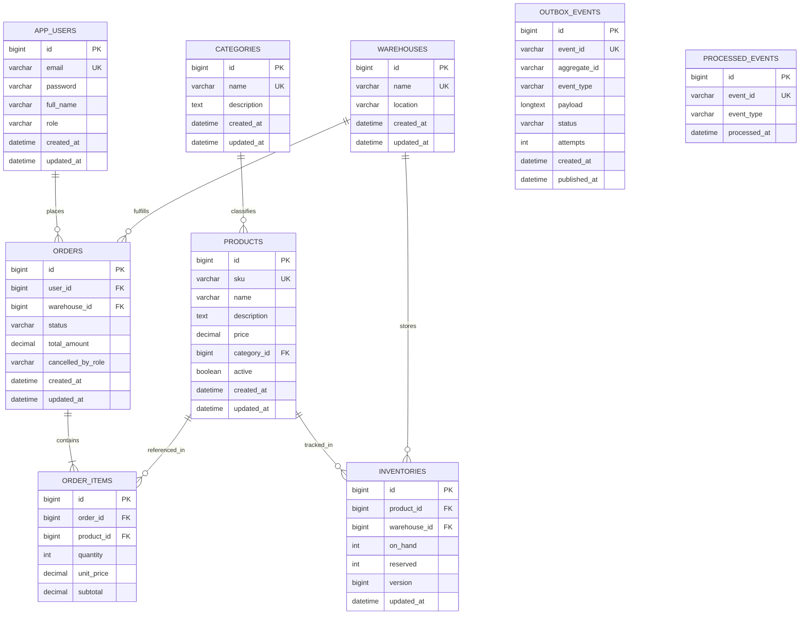
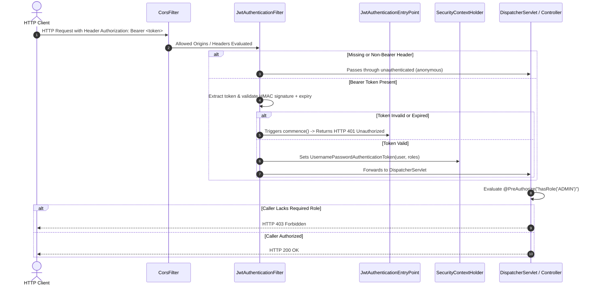
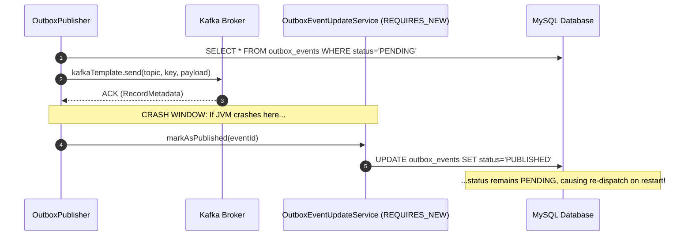
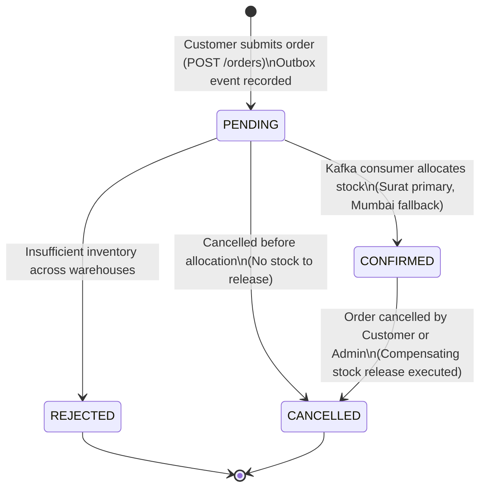
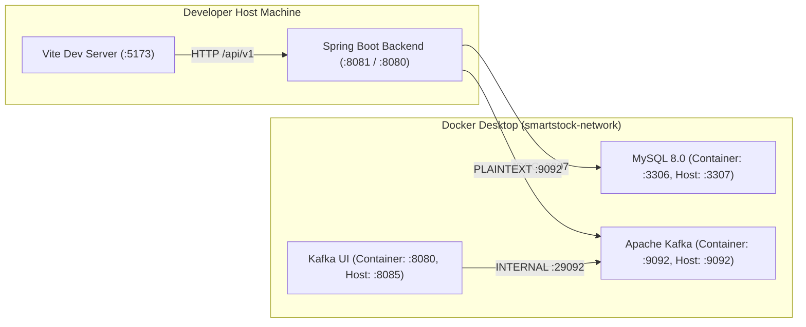

# SmartStock Backend Architecture, Design & Implementation Guide

> **Technical Reference & Architectural Reviewer Guide**  
> **Target Audience:** Software Engineers, Backend Developers, Technical Interviewers, and Architecture Reviewers.  
> **Repository Module:** `smartstock-backend` (Spring Boot 3.3.4 / Java 17)  
> **Companion Guide:** [FRONTEND_GUIDE.md](../frontend/FRONTEND_GUIDE.md)  
> **Source Directory:** [src/main/java](src/main/java)

---

## Table of Contents
1. [Project Overview](#1-project-overview)
2. [Backend Architecture](#2-backend-architecture)
3. [Database Design & Data Model](#3-database-design--data-model)
4. [Spring Boot Fundamentals & Framework Internals](#4-spring-boot-fundamentals--framework-internals)
5. [Authentication & Authorization Deep Dive](#5-authentication--authorization-deep-dive)
6. [Comprehensive REST API Reference](#6-comprehensive-rest-api-reference)
7. [Apache Kafka & Event-Driven Architecture](#7-apache-kafka--event-driven-architecture)
8. [Transactional Outbox Pattern Implementation](#8-transactional-outbox-pattern-implementation)
9. [Inventory Reservation, Concurrency & Stock Integrity](#9-inventory-reservation-concurrency--stock-integrity)
10. [Order Lifecycle & State Transitions](#10-order-lifecycle--state-transitions)
11. [Testing Strategy & Test Suite Breakdown](#11-testing-strategy--test-suite-breakdown)
12. [Configuration, Infrastructure & DevOps](#12-configuration-infrastructure--devops)
13. [Key Architectural Decisions & Trade-Offs](#13-key-architectural-decisions--trade-offs)
14. [Limitations & Production Roadmap](#14-limitations--production-roadmap)
15. [Comprehensive Interview Preparation (50+ Questions & Answers)](#15-comprehensive-interview-preparation-50-questions--answers)
16. [How to Pitch SmartStock in an Interview](#16-how-to-pitch-smartstock-in-an-interview)

---

## 1. Project Overview

### What is SmartStock?
**SmartStock** is an inventory and order management system engineered as a **Modular Monolith** in Java 17 and Spring Boot 3.3.4. It coordinates catalog management, multi-warehouse stock tracking, asynchronous order fulfillment, and role-based access control (RBAC).

```
+---------------------------------------------------------------------------------------------------+
|                                      SmartStock Ecosystem                                         |
+---------------------------------------------------------------------------------------------------+
|                                                                                                   |
|  [React / Vite Web UI]   <====== HTTP / REST ======>   [Spring Boot Modular Monolith Backend]      |
|                                                                     |                             |
|                                                +--------------------+-------------------+         |
|                                                |                                        |         |
|                                                v                                        v         |
|                                      [(Local) MySQL 8.0 DB]                  [Apache Kafka KRaft] |
|                                      - Relational Data                       - order.created.v1   |
|                                      - outbox_events                         - order.created.v1.DLT|
|                                      - processed_events                      - inventory.reserved |
+---------------------------------------------------------------------------------------------------+
```

### Real-World Problem It Solves
Modern e-commerce and supply chain backends face three common architectural pitfalls during high-traffic checkout events:

1. **The Dual-Write Loss Problem:** When an application updates a database and publishes to an event broker independently, network or database partitions lead to inconsistencies (e.g., an order is saved in the database, but the event broker call fails; or an event is published, but the database transaction rolls back).
2. **Race Conditions and Inventory Overselling:** Multiple customers simultaneously attempt to purchase remaining stock. Naive `SELECT-then-UPDATE` logic leads to negative inventory, customer friction, and fulfillment failures.
3. **Checkout Latency Bottlenecks:** Forcing a synchronous checkout call to calculate routing, query multi-region warehouse stock levels, execute locks, and wait for payment confirmation creates high latency and connection pool exhaustion.

**SmartStock addresses these challenges by:**
* Mitigating dual-write message loss by storing domain events in a persistent `outbox_events` table within the same database transaction as the order.
* Decoupling warehouse stock reservation into an **asynchronous event-driven pipeline powered by Apache Kafka**.
* Executing atomic conditional SQL updates at the database row level to ensure that stock reservations only succeed when sufficient inventory exists.
* Enforcing **idempotent message consumption** using dedicated tracking tables (`processed_events`) to handle at-least-once message delivery.
* Enforcing **all-or-nothing single-warehouse order fulfillment** across multi-warehouse geographical priorities (Surat primary, Mumbai fallback).

### Core Features
* **Stateless JWT Security & RBAC:** Secure authentication with BCrypt password hashing and declarative role-based access control (`ROLE_CUSTOMER`, `ROLE_ADMIN`).
* **Catalog & Product Management:** Category hierarchy, SKU format validation, price auditing with `BigDecimal`, and soft-deactivation.
* **Multi-Warehouse Stock Tracking:** Real-time visibility into `onHand`, `reserved`, and dynamically computed `available` inventory across multiple logistics hubs.
* **Transactional Outbox Polling:** Scheduled, transactionally isolated background publisher dispatching domain events to Kafka.
* **Deterministic Single-Warehouse Fulfillment:** Fulfillment routing that prioritizes Surat Warehouse and falls back to Mumbai Warehouse, with instant compensation rollback on partial stock shortage.
* **Order Cancellation & Stock Compensation:** Dual-actor cancellation (Customer/Admin) with automatic inventory release for confirmed orders and actor role attribution (`cancelledByRole`).
* **Dead Letter Topic (DLT) Routing:** Built-in routing for malformed or unprocessable JSON payloads to prevent poison pills from blocking partitions.

### Technology Stack & Justification

| Technology | Version | Purpose in SmartStock | Architectural Justification |
| :--- | :--- | :--- | :--- |
| **Java** | 17 LTS | Core Programming Language | Provides modern language capabilities (Records, Pattern Matching for `switch`/`instanceof`, Text Blocks) with long-term enterprise support and efficient garbage collection. |
| **Spring Boot** | 3.3.4 | Backend Framework | Provides auto-configuration, embedded Tomcat, dependency injection container, and ecosystem starter libraries. |
| **Spring Security** | 6.x | Security Framework | Provides an extensible, stateless HTTP filter chain, security context management, and declarative method security (`@PreAuthorize`). |
| **JJWT** | 0.12.6 | JWT Token Generation & Validation | Lightweight Java library for RFC 7519 compliant JSON Web Token creation, cryptographic signing (HMAC-SHA256), and claim extraction. |
| **Spring Data JPA / Hibernate** | 6.x | Object-Relational Mapping (ORM) | Abstract repository interfaces, dirty checking, declarative transactions (`@Transactional`), and entity optimistic locking via `@Version`. |
| **MySQL** | 8.0 | Primary Relational Database | ACID-compliant storage engine (InnoDB) providing row-level locking, foreign key integrity constraints, and transactional consistency. |
| **Flyway** | Core + MySQL | Database Migrations | Version-controlled, reproducible SQL migration scripts (`V1`, `V2`) guaranteeing identical schema state across local, test, and production environments. |
| **Apache Kafka** | 3.8.0 (KRaft) | Event Streaming Broker | Distributed append-only log running in KRaft mode (no Zookeeper required). Decouples order placement from inventory fulfillment. |
| **Spring Kafka** | 3.3.x | Kafka Integration Layer | Provides `KafkaTemplate`, `@KafkaListener`, container lifecycle management, manual acknowledgment modes, and `DeadLetterPublishingRecoverer`. |
| **Lombok** | 1.18.34 | Boilerplate Reduction | Generates constructors, getters, setters, and builders at compile-time to maintain clean, readable entity and DTO source code. |
| **Docker & Docker Compose**| Compose v2 | Local Infrastructure Orchestration | One-command spin-up for local MySQL 8.0, Kafka KRaft, and Kafka UI, ensuring developer environment parity. |
| **JUnit 5, Mockito & AssertJ** | Modern | Test Automation Suite | Enables thorough unit testing, WebMvc slice testing, and integration testing using an in-memory MySQL-mode H2 database and mocked Kafka components. |

---

## 2. Backend Architecture

### The Modular Monolith Pattern
SmartStock is designed as a **Modular Monolith**. Rather than prematurely splitting the system into distributed microservices—which introduces distributed transactions, network latency, operational overhead, and deployment complexity—SmartStock groups business logic into distinct, loosely coupled domain modules within a single deployable artifact (`smartstock-backend-0.0.1-SNAPSHOT.jar`).

```
+----------------------------------------------------------------------------------------------------+
|                                      Spring Boot Application Root                                  |
|                                     com.smartstock.SmartStockApplication                           |
+----------------------------------------------------------------------------------------------------+
       |                                   |                                    |
       v                                   v                                    v
+------------------+             +-------------------+                +--------------------+
|  MODULE: Auth    |             | MODULE: Inventory |                |   MODULE: Order    |
|                  |             |                   |                |                    |
| - AppUser        |             | - Category        |                | - Order            |
| - UserRole       |             | - Product         |                | - OrderItem        |
| - AuthController |             | - Warehouse       |                | - OrderStatus      |
| - AuthService    |             | - Inventory       |                | - OrderController  |
| - JwtService     |             | - InventoryService|                | - OrderService     |
+------------------+             +-------------------+                +--------------------+
       |                                   ^                                    |
       |                                   |                                    |
       +-----------------------------+     |  (Async Kafka Event Pipeline)      |
                                     |     |                                    |
                                     v     |                                    v
                              +----------------------------------------------------+
                              |                  MODULE: Common                    |
                              | - Transactional Outbox (OutboxEvent, Publisher)    |
                              | - Event Processing Log (ProcessedEvent)            |
                              | - Web Response Envelope (ApiResponse<T>)           |
                              | - Global Exception Handling (GlobalExceptionHandler)|
                              +----------------------------------------------------+
```

### Package-by-Feature Structure
The codebase strictly follows a package-by-feature layout rooted under `com.smartstock`:

* `com.smartstock.modules.auth`: User accounts, credentials, BCrypt password hashing, authentication endpoints.
* `com.smartstock.modules.inventory`: Product catalog, taxonomy categories, multi-region warehouses, and inventory stock tracking.
* `com.smartstock.modules.order`: Order placement, items, status tracking, cancellations, and domain events.
* `com.smartstock.common`: Cross-cutting infrastructure:
  * `config`: Security, Kafka, CORS, WebMvc configurations.
  * `security`: JWT authentication filter, user details service, unauthorized entry points.
  * `event`: Transactional Outbox entities, repositories, and scheduled publishers.
  * `response`: Unified `ApiResponse<T>` envelope.
  * `exception`: Custom exceptions and `@RestControllerAdvice` global exception mapper.

### Layered Architecture Inside Modules
Each domain module adheres to a strict 5-layer separation of concerns:

```
[ HTTP Client Request ]
         │
         ▼
 1. Controller Layer     --> Validates HTTP payload (@Valid), unwraps headers, returns ResponseEntity<ApiResponse<T>>
         │
         ▼
 2. Service Layer        --> Orchestrates business logic, transaction boundaries (@Transactional), domain rules
         │
         ▼
 3. Repository Layer     --> Data access abstraction (Spring Data JPA JpaRepository), JPQL, custom conditional queries
         │
         ▼
 4. Entity Layer         --> Relational mapping (JPA @Entity), schema constraints, lifecycle hooks (@PrePersist)
         │
         ▼
[ MySQL 8.0 Database ]
```

---

## 3. Database Design & Data Model

### Relational Schema (ER Diagram)



### Entity Deep Dive

#### 1. `AppUser` ([src/main/java/com/smartstock/modules/auth/model/AppUser.java](src/main/java/com/smartstock/modules/auth/model/AppUser.java))
* **Table:** `users`
* **Purpose:** Represents authenticated principals (customers and administrators).
* **Key Columns:** `email` (unique index), `password` (BCrypt hash), `role` (`CUSTOMER`, `ADMIN`).

#### 2. `Category` ([src/main/java/com/smartstock/modules/inventory/model/Category.java](src/main/java/com/smartstock/modules/inventory/model/Category.java))
* **Table:** `categories`
* **Purpose:** High-level product taxonomy grouping.
* **Key Columns:** `name` (unique index), `description`.

#### 3. `Product` ([src/main/java/com/smartstock/modules/inventory/model/Product.java](src/main/java/com/smartstock/modules/inventory/model/Product.java))
* **Table:** `products`
* **Purpose:** Master catalog record.
* **Key Columns:**
  * `sku` (`VARCHAR(50) UNIQUE NOT NULL`): Business stock-keeping unit.
  * `price` (`DECIMAL(10,2) NOT NULL`): Monetary unit value modeled as `BigDecimal`.
  * `active` (`BOOLEAN NOT NULL DEFAULT TRUE`): Soft-deactivation flag.

#### 4. `Warehouse` ([src/main/java/com/smartstock/modules/inventory/model/Warehouse.java](src/main/java/com/smartstock/modules/inventory/model/Warehouse.java))
* **Table:** `warehouses`
* **Purpose:** Physical fulfillment and distribution hubs.
* **Key Columns:** `name` (`Surat Warehouse`, `Mumbai Warehouse`), `location`.

#### 5. `Inventory` ([src/main/java/com/smartstock/modules/inventory/model/Inventory.java](src/main/java/com/smartstock/modules/inventory/model/Inventory.java))
* **Table:** `inventories`
* **Purpose:** Real-time stock levels of a product within a specific warehouse.
* **Key Columns:**
  * `product_id`, `warehouse_id`: Composite unique constraint `uk_inventories_product_warehouse`.
  * `on_hand`: Physical stock count on warehouse shelves.
  * `reserved`: Units allocated to active confirmed/pending orders but not yet packed.
  * `version`: JPA `@Version` column supporting optimistic concurrency for entity updates.
* **Transient Method:**
  ```java
  @Transient
  public int getAvailable() {
      int currentOnHand = (this.onHand != null) ? this.onHand : 0;
      int currentReserved = (this.reserved != null) ? this.reserved : 0;
      return currentOnHand - currentReserved;
  }
  ```

#### 6. `Order` ([src/main/java/com/smartstock/modules/order/model/Order.java](src/main/java/com/smartstock/modules/order/model/Order.java))
* **Table:** `orders`
* **Purpose:** Customer purchase transaction.
* **Key Columns:** `status` (`PENDING`, `CONFIRMED`, `REJECTED`, `CANCELLED`), `total_amount`, `cancelled_by_role` (`CUSTOMER`, `ADMIN`).

#### 7. `OrderItem` ([src/main/java/com/smartstock/modules/order/model/OrderItem.java](src/main/java/com/smartstock/modules/order/model/OrderItem.java))
* **Table:** `order_items`
* **Purpose:** Line item belonging to an order.
* **Historical Price Snapshot:** Contains `unit_price` (`DECIMAL(10,2)`). This snapshots product price at the exact moment of order placement, insulating historical receipts from future catalog price adjustments.

#### 8. `OutboxEvent` ([src/main/java/com/smartstock/common/event/model/OutboxEvent.java](src/main/java/com/smartstock/common/event/model/OutboxEvent.java))
* **Table:** `outbox_events`
* **Purpose:** Stores domain events intended for Kafka publication within the database transaction.
* **Key Columns:** `event_id` (UUID), `aggregate_id` (Order ID), `event_type` (`OrderCreated`), `payload` (`LONGTEXT` JSON), `status` (`PENDING`, `PUBLISHED`, `FAILED`), `attempts`.

#### 9. `ProcessedEvent` ([src/main/java/com/smartstock/common/event/model/ProcessedEvent.java](src/main/java/com/smartstock/common/event/model/ProcessedEvent.java))
* **Table:** `processed_events`
* **Purpose:** Idempotency ledger for Kafka consumers.
* **Key Columns:** `event_id` (`VARCHAR(100) UNIQUE NOT NULL`). Prevents duplicate execution if a message is redelivered.

---

## 4. Spring Boot Fundamentals & Framework Internals

### Application Startup Lifecycle
1. `SpringApplication.run(SmartStockApplication.class, args)` initializes.
2. `Environment` loads properties from `application.yml` and environment variables.
3. `ApplicationContext` is constructed; component scanning registers beans (`@Component`, `@Service`, `@Repository`, `@RestController`).
4. Flyway executes database migrations (`V1`, `V2`).
5. Hibernate verifies entities against the database schema (`hibernate.ddl-auto: validate`).
6. Embedded Tomcat starts on port `8080` (or `8081` when overridden by `SERVER_PORT`).

### Dependency Injection & IoC
SmartStock uses **Constructor-Based Dependency Injection** enforced via Lombok's `@RequiredArgsConstructor`:
```java
@Service
@RequiredArgsConstructor
public class OrderService {
    private final OrderRepository orderRepository;
    private final InventoryRepository inventoryRepository;
    private final OutboxEventRepository outboxEventRepository;
    private final ObjectMapper objectMapper;
}
```
* Dependencies are marked `final`, ensuring immutability.
* Circular dependencies fail fast at startup.
* Unit testing is simplified because mock dependencies can be passed directly via constructor without reflection.

### Transaction Management (`@Transactional`)
Spring proxies `@Transactional` methods using AOP (Aspect-Oriented Programming):
1. **Aspect Interception:** A proxy intercepts the method call.
2. **Connection Acquisition:** A database connection is obtained from the HikariCP connection pool.
3. **Transaction Start:** `connection.setAutoCommit(false)` is executed.
4. **Method Execution:** The target method runs.
5. **Commit / Rollback:** On normal completion, `connection.commit()` is called. If an unchecked exception (`RuntimeException` or `Error`) occurs, `connection.rollback()` is executed.

---

## 5. Authentication & Authorization Deep Dive

### Spring Security Filter Chain ([src/main/java/com/smartstock/common/config/SecurityConfig.java](src/main/java/com/smartstock/common/config/SecurityConfig.java))



### JWT Structure & Claims
* **Header:** `{"alg": "HS256", "typ": "JWT"}`
* **Payload:** Subject (User Email), `role` claim (`ROLE_CUSTOMER` or `ROLE_ADMIN`), `iat` (Issued At), `exp` (Expiration - 24 hours).
* **Signature:** HMAC-SHA256 hash using `smartstock.jwt.secret`.

---

## 6. Comprehensive REST API Reference

Every endpoint returns a unified JSON envelope:
```json
{
  "success": true,
  "message": "Human readable confirmation",
  "data": { ... },
  "timestamp": "2026-11-14T17:00:00"
}
```

### Module 1: Authentication (`/api/v1/auth`)

| Method | Endpoint | Access | Purpose |
| :--- | :--- | :--- | :--- |
| `POST` | `/api/v1/auth/register` | Public | Register a new customer account (`ROLE_CUSTOMER`). |
| `POST` | `/api/v1/auth/login` | Public | Authenticate credentials and obtain JWT bearer token. |
| `GET` | `/api/v1/auth/me` | Authenticated | Retrieve authenticated user profile and roles. |

### Module 2: Categories (`/api/v1/categories`)

| Method | Endpoint | Access | Purpose |
| :--- | :--- | :--- | :--- |
| `GET` | `/api/v1/categories` | Public | List all product categories. |
| `GET` | `/api/v1/categories/{id}` | Public | Retrieve category by ID. |
| `POST` | `/api/v1/categories` | `ADMIN` | Create a new category. |
| `PUT` | `/api/v1/categories/{id}` | `ADMIN` | Update an existing category. |
| `DELETE`| `/api/v1/categories/{id}` | `ADMIN` | Delete category (blocked if products are linked). |

### Module 3: Products (`/api/v1/products`)

| Method | Endpoint | Access | Purpose |
| :--- | :--- | :--- | :--- |
| `GET` | `/api/v1/products` | Public | List active products (Admins see active and inactive). |
| `GET` | `/api/v1/products/{id}` | Public | Retrieve product details by ID. |
| `POST` | `/api/v1/products` | `ADMIN` | Register a new product with unique SKU and price. |
| `PUT` | `/api/v1/products/{id}` | `ADMIN` | Update product details (SKU is immutable). |
| `DELETE`| `/api/v1/products/{id}` | `ADMIN` | Soft-deactivate product (`active = false`). |

### Module 4: Warehouses (`/api/v1/warehouses`)

| Method | Endpoint | Access | Purpose |
| :--- | :--- | :--- | :--- |
| `GET` | `/api/v1/warehouses` | Public | List regional distribution hubs. |
| `GET` | `/api/v1/warehouses/{id}`| Public | Get warehouse details by ID. |
| `POST` | `/api/v1/warehouses` | `ADMIN` | Register a new distribution hub. |
| `PUT` | `/api/v1/warehouses/{id}`| `ADMIN` | Update warehouse details. |

### Module 5: Inventory (`/api/v1/inventory`)

| Method | Endpoint | Access | Purpose |
| :--- | :--- | :--- | :--- |
| `GET` | `/api/v1/inventory` | Public | View inventory across all warehouses. |
| `GET` | `/api/v1/inventory/warehouse/{id}` | Public | View inventory for a specific warehouse. |
| `GET` | `/api/v1/inventory/product/{id}` | Public | View inventory for a specific product. |
| `POST` | `/api/v1/inventory/adjust` | `ADMIN` | Adjust physical on-hand stock (`newOnHand >= reserved`). |

### Module 6: Orders (`/api/v1/orders`)

| Method | Endpoint | Access | Purpose |
| :--- | :--- | :--- | :--- |
| `POST` | `/api/v1/orders` | `CUSTOMER` | Submit new order (status `PENDING`; Outbox recorded). |
| `GET` | `/api/v1/orders` | `CUSTOMER` | List orders placed by authenticated customer. |
| `GET` | `/api/v1/orders/{id}` | Authenticated | View order details (owner or admin). |
| `POST` | `/api/v1/orders/{id}/cancel` | Authenticated | Cancel order (owner or admin; releases stock if confirmed). |

### Module 7: Admin Orders (`/api/v1/admin/orders`)

| Method | Endpoint | Access | Purpose |
| :--- | :--- | :--- | :--- |
| `GET` | `/api/v1/admin/orders` | `ADMIN` | View paginated orders across all customers with status filter. |
| `GET` | `/api/v1/admin/orders/{id}` | `ADMIN` | Inspect detailed order metadata. |
| `POST` | `/api/v1/admin/orders/{id}/cancel` | `ADMIN` | Cancel any customer order with admin role attribution. |

---

## 7. Apache Kafka & Event-Driven Architecture

### Architectural Topology
SmartStock uses Kafka to decouple checkout order submission from multi-warehouse stock reservation:

```
 [Order Placement] -> DB Commit (Order + OutboxEvent)
                           │
                    OutboxPublisher
                           │
                           ▼
                  Kafka Topic: order.created.v1
                ┌──────────┬──────────┬──────────┐
                │Part. 0   │Part. 1   │Part. 2   │
                │          │[Order 42]│          │  <- Key: aggregateId (42)
                └──────────┴──────────┴──────────┘
                           │
               OrderCreatedKafkaListener
                 (smartstock-group)
                           │
              InventoryReservationService
                           │
             ┌─────────────┴─────────────┐
             ▼                           ▼
    Stock Reserved              Poison / Corrupted
    (CONFIRMED)                 (Routed to order.created.v1.DLT)
```

### Kafka Configuration Breakdown
* **Broker:** Apache Kafka 3.8.0 operating in KRaft mode (no Zookeeper).
* **Local Replication Factor:** Configured with `partitions(3)` and `replicas(1)` in [KafkaConfig.java](src/main/java/com/smartstock/common/config/KafkaConfig.java). In local Docker Compose, a single Kafka broker is run (`KAFKA_OFFSETS_TOPIC_REPLICATION_FACTOR: 1`). Note: While `acks=all` is configured, with a replication factor of 1, acknowledgment is satisfied by the single local leader broker. This is a local development configuration, not a fault-tolerant multi-node cluster.
* **Message Partition Key:** The Kafka message key is set to `aggregateId` (the Order ID string). This ensures all events for a given order hash to the same partition, preserving chronological ordering.
* **Producer Acknowledgment:** `acks=all` and `retries=3`.
* **Consumer Group:** `smartstock-group`.
* **Consumer Acknowledgment:** `ContainerProperties.AckMode.MANUAL_IMMEDIATE`. The consumer commits the partition offset **only after the database transaction successfully commits**.
* **Delivery Guarantees:** Kafka provides **at-least-once delivery**. If a network failure occurs after processing but before offset commit, messages may be redelivered.

### Dead Letter Topic (DLT) & Poison Pill Handling
A poison pill is a malformed message that cannot be processed. SmartStock implements a two-tier handling strategy:
1. **Application-Level Routing in [OrderCreatedKafkaListener.java](src/main/java/com/smartstock/modules/inventory/consumer/OrderCreatedKafkaListener.java):**
   * If Jackson throws `JsonProcessingException` or required fields (`eventId`, `orderId`) are missing, the listener catches the error, dispatches the payload to `order.created.v1.DLT`, and acknowledges the source message.
   * **Important Failure Behavior:** If dispatching to the DLT fails (e.g. timeout or broker exception), `sendToDlt` throws a `RuntimeException`, and acknowledgment is deliberately **not** called. This prevents message loss even on the dead-lettering path.
2. **Container Error Handler in [KafkaConfig.java](src/main/java/com/smartstock/common/config/KafkaConfig.java):**
   * Configured with `DefaultErrorHandler(DeadLetterPublishingRecoverer, FixedBackOff(1000L, 3L))`.
   * Unrecoverable exceptions (`DeserializationException`, `MessageConversionException`, `IllegalArgumentException`) bypass retries and route directly to the DLT.

---

## 8. Transactional Outbox Pattern Implementation

### The Dual-Write Loss Problem
Directly writing to MySQL and calling Kafka introduces a distributed dual-write problem:
```java
// ANTI-PATTERN: Dual-Write Risk
@Transactional
public void placeOrder(OrderRequest request) {
    Order order = orderRepository.save(new Order(...)); // Step 1: DB Write
    kafkaTemplate.send("order.created.v1", order);      // Step 2: External Network Call
}
```
* If Kafka is down, the transaction rolls back, but an in-flight network call might have already reached the broker.
* If the Kafka call occurs after transaction commit, a crash between commit and publish leaves an order in the database with no fulfillment event ever sent.

### How SmartStock Solves Dual-Write Loss
SmartStock writes the domain event into the `outbox_events` table **within the same database transaction** as the order:
```java
// OrderService.java (createOrder)
Order savedOrder = orderRepository.save(order);

OutboxEvent outboxEvent = OutboxEvent.builder()
        .eventId(eventId)
        .aggregateId(savedOrder.getId().toString())
        .eventType("OrderCreated")
        .payload(payloadJson)
        .status(OutboxStatus.PENDING)
        .build();

outboxEventRepository.save(outboxEvent);
// End of @Transactional: Both commit together or roll back together.
```

### The Dual-Write Acknowledgment Gap & Duplicate Publishing
While the Outbox Pattern prevents message loss, it provides **at-least-once delivery**, not strictly exactly-once delivery:
1. The scheduled publisher ([OutboxPublisher.java](src/main/java/com/smartstock/common/event/publisher/OutboxPublisher.java)) reads pending events and sends them to Kafka.
2. The publisher waits for broker acknowledgment: `future.get(sendTimeoutSeconds, TimeUnit.SECONDS)`.
3. After acknowledgment, the publisher invokes `outboxEventUpdateService.markAsPublished(id)` in a dedicated transaction.
4. **Crash Window:** If the application crashes or loses database connectivity *after* Kafka acknowledges the message but *before* `markAsPublished` commits, the event remains `PENDING` in the database.
5. On recovery, the publisher will re-send the message to Kafka, producing a **duplicate message**.



### Resolution via Consumer Idempotency
Because duplicate publication can occur, downstream consumers **must be idempotent**. SmartStock achieves this via the `processed_events` table:
* In [InventoryReservationService.java](src/main/java/com/smartstock/modules/inventory/service/InventoryReservationService.java), the consumer checks `processedEventRepository.existsByEventId(eventId)` before performing reservation.
* If the event was already processed, it returns `ReservationOutcome.SKIPPED_DUPLICATE` and skips stock reservation.
* The consumer acknowledges the Kafka message, safely handling the duplicate.

---

## 9. Inventory Reservation, Concurrency & Stock Integrity

### Atomic Conditional SQL Updates
Stock reservation does **not** rely on in-memory validation. Instead, [InventoryRepository.java](src/main/java/com/smartstock/modules/inventory/repository/InventoryRepository.java) executes an atomic conditional update:

```sql
UPDATE inventories i
SET i.reserved = i.reserved + :quantity,
    i.version = i.version + 1,
    i.updated_at = CURRENT_TIMESTAMP
WHERE i.product_id = :productId
  AND i.warehouse_id = :warehouseId
  AND (i.on_hand - i.reserved) >= :quantity;
```

#### Why This Is Concurrency-Safe
1. **Row-Level Write Lock:** MySQL InnoDB places an exclusive write lock (`X-lock`) on the matching index record during the update.
2. **Atomic Condition Evaluation:** The condition `(i.on_hand - i.reserved) >= :quantity` is evaluated inside the storage engine while holding the lock.
3. **Row Count Feedback:**
   * If stock is available, 1 row is updated (`rowsAffected = 1`).
   * If concurrent orders claimed the stock, 0 rows are updated (`rowsAffected = 0`). The service detects this immediately and avoids overselling.

### The Role of `@Version` vs. Atomic Updates
* **The custom JPQL query is an atomic conditional update, not optimistic locking.** Notice that its `WHERE` clause does not check `WHERE i.version = :expectedVersion`. It directly checks available stock `(i.on_hand - i.reserved) >= :quantity`. It increments `i.version = i.version + 1` so that Hibernate's version counter remains synchronized.
* **The actual role of `@Version`:** On the `Inventory` entity, `@Version private Long version = 0L;` protects standard JPA entity updates (such as admin stock adjustments in `InventoryService.adjustStock()` where the entity is loaded, modified, and saved via `inventoryRepository.save(inventory)`). In those operations, Hibernate includes `WHERE id = ? AND version = ?` and throws `OptimisticLockException` if concurrent modifications occur.

### Pessimistic Write Locking on Orders
In [InventoryReservationService.java](src/main/java/com/smartstock/modules/inventory/service/InventoryReservationService.java):
```java
Order order = orderRepository.findByIdForUpdate(orderId)
        .orElseThrow(() -> new ResourceNotFoundException("Order not found with ID: " + orderId));
```
In [OrderRepository.java](src/main/java/com/smartstock/modules/order/repository/OrderRepository.java):
```java
@Lock(LockModeType.PESSIMISTIC_WRITE)
@Query("SELECT o FROM Order o WHERE o.id = :id")
Optional<Order> findByIdForUpdate(@Param("id") Long id);
```
Translates to `SELECT * FROM orders WHERE id = ? FOR UPDATE;`. This serializes concurrent operations between the asynchronous Kafka consumer (confirming the order) and a user requesting cancellation via the REST API.

### All-or-Nothing Multi-Item Reservation & Priority Routing
* **Fulfillment Priority:** Surat Warehouse is evaluated first; Mumbai Warehouse is evaluated as fallback.
* **All-or-Nothing Guarantee:** If an order requires 3 items, and Item 1 and Item 2 succeed but Item 3 fails:
  * The service immediately executes compensating calls to `releaseStock(...)` for Item 1 and Item 2.
  * No partial reservation remains at that warehouse.
  * The service then evaluates the fallback warehouse. If neither can fulfill 100% of items, the order status becomes `REJECTED`.

---

## 10. Order Lifecycle & State Transitions

### State Machine Diagram



### Order Cancellation Implementation
Implemented in `OrderService.cancelOrder(orderId, userEmail, isAdmin)`:
1. Acquires a pessimistic lock on the order (`findByIdForUpdate`).
2. Validates ownership: Customers can only cancel their own orders; Admins can cancel any order.
3. Validates status: If already `CANCELLED` or `REJECTED`, throws `IllegalStateException`.
4. **Stock Compensation:** If status is `CONFIRMED`, iterates over order items and invokes `inventoryRepository.releaseStock(...)` to release reserved inventory.
5. If status is `PENDING`, updates status directly to `CANCELLED`. When the Kafka consumer later processes the event, it detects `order.getStatus() != OrderStatus.PENDING`, skips reservation, and logs the event in `processed_events`.
6. Sets `cancelledByRole` to `ADMIN` or `CUSTOMER`.

---

## 11. Testing Strategy & Test Suite Breakdown

### Testing Architecture
SmartStock maintains an automated test suite verifying unit logic, MVC endpoints, and end-to-end event workflows.

> [!IMPORTANT]
> **Database & Broker Testing Environment:**
> * All database integration tests run against an **in-memory H2 database in MySQL compatibility mode** (`MODE=MySQL;DATABASE_TO_LOWER=TRUE`) with Flyway migrations enabled (configured in [src/test/resources/application-test.yml](src/test/resources/application-test.yml)).
> * Automated tests do **not** run against a live Kafka broker or Testcontainers. Instead, `@Profile("test")` activates [TestKafkaConfig.java](src/test/java/com/smartstock/config/TestKafkaConfig.java) which provides a Mockito mock `KafkaTemplate`, and Kafka auto-configuration is excluded.
> * Workflow tests (such as `OrderEndToEndWorkflowIntegrationTests`) test the outbox publisher and consumer by invoking listener methods in-process with mocked acknowledgments.

### Test Suite Matrix (102 Test Methods Across 13 Test Classes)

| Test Class | Methods | Test Type | Database / Mocking Strategy | Scenarios Tested |
| :--- | :---: | :--- | :--- | :--- |
| **`AdminAccountSeederTests`** | 6 | Integration | H2 MySQL mode, `@SpringBootTest` | Seed admin creation, idempotency on restart, disabling via property. |
| **`AuthControllerTests`** | 9 | Integration / Slice | H2 MySQL mode, MockMvc | Registration, duplicate email rejection, BCrypt hashing, JWT generation, RBAC rules. |
| **`DatabaseLayerTests`** | 4 | JPA Persistence | H2 MySQL mode, Repositories | Foreign keys, composite unique constraint on `Inventory`, auditing timestamps. |
| **`DevelopmentDataSeederTests`** | 6 | Integration | H2 MySQL mode, `@SpringBootTest` | Sample catalog and stock seeding, idempotency without duplicate rows. |
| **`InventoryModuleIntegrationTests`** | 15 | WebMvc / Integration | H2 MySQL mode, MockMvc | Category CRUD, product creation, SKU constraints, soft deletion, stock adjustments. |
| **`InventoryReservationServiceIntegrationTests`** | 11 | Concurrency Integration | H2 MySQL mode, multi-threaded `ExecutorService` | Multi-threaded checkout contention, all-or-nothing rollback, simulated failure rollback. |
| **`OrderCreatedKafkaListenerTests`** | 9 | Unit Test | `@ExtendWith(MockitoExtension.class)` | Listener deserialization, DLT routing on malformed JSON, duplicate skip, retry re-throw. |
| **`OrderEndToEndWorkflowIntegrationTests`** | 7 | Workflow Integration | H2 MySQL mode, MockMvc, Mocked `KafkaTemplate` | Order placement $\to$ outbox publish $\to$ in-process consumer reservation $\to$ status confirmation. |
| **`OrderModuleIntegrationTests`** | 20 | WebMvc / Integration | H2 MySQL mode, MockMvc | Order placement, inactive SKU rejection, customer isolation, admin viewing, cancellations. |
| **`OutboxEventUpdateServiceTests`** | 3 | Unit Test | `@ExtendWith(MockitoExtension.class)` | `markAsPublished` timestamp update, `markAsFailed` retry counter increment. |
| **`OutboxPublisherIntegrationTests`** | 3 | Outbox Integration | H2 MySQL mode, Mocked `KafkaTemplate` | Polling pending events, status transition to `PUBLISHED`, failure status handling. |
| **`OutboxPublisherTests`** | 8 | Unit Test | `@ExtendWith(MockitoExtension.class)` | Publisher guards, ordering keys, broker timeout handling, retry attempts. |
| **`SmartStockApplicationTests`** | 1 | Smoke Test | Full Spring Context | Verifies `ApplicationContext` bootstraps cleanly with all beans. |
| **Total** | **102** | | | |

### Running the Test Suite
```bash
# Navigate to backend directory
cd backend

# Execute all 102 tests
./mvnw clean test

# Execute a single test class
./mvnw test -Dtest=InventoryReservationServiceIntegrationTests
```

---

## 12. Configuration, Infrastructure & DevOps

### Port Configuration: Container-Internal vs. Host-Mapped
Understanding the port mapping between local development, host processes, and Docker containers is essential:

| Service | Container-Internal Port | Host-Mapped Port | Notes |
| :--- | :--- | :--- | :--- |
| **Spring Boot Backend** | N/A (Host process) | `8080` (default) / `8081` (local `.env`) | Defined in `application.yml` as `${SERVER_PORT:8080}`; overridden in local `.env` to `8081`. Context path: `/api/v1`. |
| **MySQL Database** | `3306` | `3307` (default in docker-compose) | In [docker-compose.yml](../infrastructure/docker-compose.yml): `"${MYSQL_PORT:-3307}:3306"`. Backend connects to `localhost:3307`. |
| **Apache Kafka Broker** | `9092` (PLAINTEXT), `29092` (INTERNAL) | `9092` | Advertised: `PLAINTEXT://localhost:9092,INTERNAL://kafka:29092`. |
| **Kafka Web UI** | `8080` | `8085` | In `docker-compose.yml`: `"${KAFKA_UI_PORT:-8085}:8080"`. Access via `http://localhost:8085`. |
| **Vite Frontend** | N/A (Host process) | `5173` | Communicates with backend via `VITE_API_BASE_URL`. |



---

## 13. Key Architectural Decisions & Trade-Offs

| Decision | Selected Choice | Alternative Considered | Trade-Off & Justification |
| :--- | :--- | :--- | :--- |
| **System Architecture** | Modular Monolith | Microservices | Eliminates distributed network overhead, distributed transactions, and multi-service deployment complexity while maintaining clean module boundaries. |
| **Event Reliability** | Transactional Outbox | Direct Kafka Publishing | Eliminates dual-write message loss; accepts slight polling latency (2s default) and requires downstream consumer idempotency. |
| **Concurrency Model** | Atomic Conditional Update | In-Memory Locks (`ReentrantLock`) | In-memory locks fail when scaling beyond a single JVM node. Atomic SQL updates enforce consistency inside the shared database engine. |
| **Stock Fulfillment** | Single-Warehouse All-or-Nothing | Multi-Warehouse Split Orders | Simplifies shipping logistics and customer invoicing; orders fail if no single warehouse can fulfill the complete basket. |
| **Kafka Testing** | Mocked Kafka (`TestKafkaConfig`) | Embedded Kafka / Testcontainers | Avoids slow startup times and resource overhead in CI; unit and workflow tests verify business logic with predictable mocks. |

---

## 14. Limitations & Production Roadmap

### Implemented Features vs. Proposed Improvements

| Domain | Currently Implemented | Proposed Production Improvement |
| :--- | :--- | :--- |
| **Event Outbox** | Scheduled polling publisher (`@Scheduled fixedDelay = 2000ms`) | Change Data Capture (CDC) via Debezium reading MySQL binary log to reduce polling overhead. |
| **Kafka Cluster** | Single broker with replication factor 1 (local dev) | Multi-broker cluster with replication factor 3 and `min.insync.replicas=2` for high availability. |
| **Order Status Push** | Client-initiated status check via REST API | Real-time push notifications to the frontend via WebSockets (STOMP) or Server-Sent Events (SSE). |
| **Testing Broker** | Mocked `KafkaTemplate` in unit and integration tests | Integration test suite using Testcontainers running a real containerized Kafka instance. |
| **Token Renewal** | Stateless JWT with 24-hour expiration | Refresh token rotation with revocation lists stored in Redis. |

---

## 15. Comprehensive Interview Preparation (50+ Questions & Answers)

### Category 1: Architecture & Fundamentals (Q1–Q10)

#### Q1: Why did you choose a Modular Monolith over Microservices?
**Answer:** Microservices introduce distributed transactions, network latency, independent deployment pipelines, and operational overhead. For SmartStock, a Modular Monolith provides clean domain boundaries (`auth`, `inventory`, `order`, `common`) within a single deployable artifact, allowing in-process calls and ACID transactions while retaining a clear path to extract services if organizational scale demands it.

#### Q2: What is the dual-write problem?
**Answer:** The dual-write problem occurs when an application must update a database and publish an event to a message broker. Because these two systems cannot participate in a single lightweight transaction, any failure between the database write and the broker publish leaves the systems in an inconsistent state.

#### Q3: How does the Transactional Outbox pattern solve dual-write loss?
**Answer:** Instead of publishing directly to Kafka during checkout, the domain event is persisted into an `outbox_events` table within the same ACID database transaction as the order. If the transaction commits, both are saved; if it rolls back, neither is saved. A background publisher then reads pending events and dispatches them to Kafka.

#### Q4: Does the Transactional Outbox guarantee exactly-once delivery?
**Answer:** No. It guarantees **at-least-once delivery**. If the publisher sends the message to Kafka and receives an acknowledgment, but the application crashes before the publisher marks the event as `PUBLISHED` in the database, the event remains `PENDING`. Upon restart, it will be published again, creating a duplicate. Downstream consumers must be idempotent.

#### Q5: How do you achieve consumer idempotency in SmartStock?
**Answer:** SmartStock tracks consumed messages in a `processed_events` table using the unique `event_id` (UUID). Before processing an `OrderCreatedEvent`, the consumer checks `processedEventRepository.existsByEventId(eventId)`. If present, it skips processing and acknowledges the Kafka offset.

#### Q6: What is the difference between `@Component`, `@Service`, and `@Repository`?
**Answer:** All three are stereotypes of `@Component` registered as Spring beans. `@Service` indicates domain business logic. `@Repository` indicates data access and enables automatic translation of vendor-specific SQL exceptions into Spring's `DataAccessException` hierarchy.

#### Q7: Why use constructor injection over `@Autowired` on fields?
**Answer:** Constructor injection ensures dependencies are immutable (`final`), prevents circular dependencies at startup, and allows straightforward instantiation with mock objects in unit tests without reflection.

#### Q8: What does `open-in-view: false` do?
**Answer:** In Spring Data JPA, Open Session In View (OSIV) keeps the database session open throughout the entire HTTP request rendering phase. Disabling it (`open-in-view: false`) ensures the Hibernate session closes as soon as the `@Transactional` service method finishes, preventing lazy-loading queries in controllers and conserving database connections.

#### Q9: How does Flyway manage database migrations?
**Answer:** Flyway scans migration scripts (`V1__...sql`, `V2__...sql`) in `src/main/resources/db/migration`. It tracks applied scripts in a `flyway_schema_history` table using checksums. On startup, it applies unexecuted scripts in order before Hibernate validation runs.

#### Q10: What is the difference between `ddl-auto: update` and `validate`?
**Answer:** `update` attempts to modify database tables to match JPA entities, which can cause accidental schema alterations in shared environments. `validate` strictly verifies that existing tables and columns match entity mappings without making changes, failing startup if a mismatch is found.

---

### Category 2: Concurrency & Database (Q11–Q20)

#### Q11: How does SmartStock prevent inventory overselling?
**Answer:** It uses an atomic conditional SQL update in [InventoryRepository.java](src/main/java/com/smartstock/modules/inventory/repository/InventoryRepository.java):
```sql
UPDATE inventories i
SET i.reserved = i.reserved + :quantity, i.version = i.version + 1
WHERE i.product_id = :productId AND i.warehouse_id = :warehouseId AND (i.on_hand - i.reserved) >= :quantity;
```
InnoDB's row write lock ensures that the condition is evaluated atomically. If available stock is insufficient, zero rows update, and the application avoids overselling.

#### Q12: Is the custom conditional query considered Optimistic Locking?
**Answer:** No. Standard optimistic locking checks `WHERE id = ? AND version = ?` and throws an `OptimisticLockException` on conflict. The custom query is an **atomic conditional update** that checks business availability `(on_hand - reserved) >= quantity`. It increments `version` to stay synchronized with Hibernate, but its concurrency control comes from the database row lock and the `WHERE` condition.

#### Q13: What is the role of `@Version` in SmartStock?
**Answer:** `@Version` is used on the `Inventory` entity to protect standard JPA entity modifications (such as admin stock adjustments via `InventoryService.adjustStock()`). When `inventoryRepository.save(inventory)` is called, Hibernate checks that the version has not changed since the entity was read.

#### Q14: Why is pessimistic locking used on the `Order` entity?
**Answer:** `orderRepository.findByIdForUpdate(orderId)` issues `SELECT ... FOR UPDATE`. This prevents race conditions between the asynchronous Kafka consumer attempting to confirm the order and a customer calling the REST API to cancel it.

#### Q15: What happens if one item in a multi-item order cannot be reserved?
**Answer:** SmartStock enforces all-or-nothing fulfillment. If Item 1 and Item 2 are reserved, but Item 3 fails, the service immediately calls `releaseStock(...)` for Items 1 and 2, rolling back partial reservations. It then tests the fallback warehouse.

#### Q16: Why are monetary amounts represented as `BigDecimal` instead of `double`?
**Answer:** `double` and `float` use binary floating-point representation (IEEE 754), which cannot represent fractions like `0.1` precisely, leading to rounding errors in calculations. `BigDecimal` provides arbitrary-precision decimal arithmetic.

#### Q17: Why snapshot `unit_price` in `OrderItem`?
**Answer:** If product catalog prices change in the future, historical orders must reflect the exact price agreed upon at checkout. Storing `unit_price` in `OrderItem` preserves historical financial accuracy.

#### Q18: What is dirty checking in Hibernate?
**Answer:** When an entity is loaded within a `@Transactional` boundary, Hibernate keeps a copy in its first-level cache. Upon transaction commit, Hibernate compares the entity's current state with the snapshot and automatically issues SQL `UPDATE` statements for modified fields without needing an explicit `save()` call.

#### Q19: What is the N+1 query problem, and how is it prevented?
**Answer:** N+1 occurs when querying an entity and subsequently executing an additional query for each child association. In SmartStock, queries like `findByIdWithDetails` in `OrderRepository` use `JOIN FETCH o.items` and `JOIN FETCH o.user` to load the parent and children in a single SQL query.

#### Q20: What is the difference between `@PrePersist` and `@PreUpdate`?
**Answer:** `@PrePersist` executes before an entity is first saved to the database (used to set creation timestamps). `@PreUpdate` executes before an existing entity is updated (used to update modification timestamps).

---

### Category 3: Kafka & Messaging (Q21–Q30)

#### Q21: Why use Apache Kafka instead of RabbitMQ for SmartStock?
**Answer:** Kafka provides an append-only, partitioned commit log with durable storage and replay capabilities. Partitioning by Order ID guarantees deterministic message ordering per order while allowing high-throughput horizontal consumer scaling.

#### Q22: What does `acks=all` mean in Kafka producer configuration?
**Answer:** The producer considers a write successful only when all in-sync replicas (ISR) acknowledge the record. In a multi-broker production cluster with replication factor 3, this ensures fault tolerance against broker crashes.

#### Q23: What is the significance of the message key in Kafka?
**Answer:** Kafka hashes the message key to assign records to a partition. Messages with the same key always go to the same partition, guaranteeing chronological ordering for that key. SmartStock uses the Order ID as the key.

#### Q24: What is the consumer offset in Kafka?
**Answer:** An offset is a sequential integer identifying each message within a partition. It tracks how far a consumer group has read.

#### Q25: Why does SmartStock use `AckMode.MANUAL_IMMEDIATE`?
**Answer:** With auto-commit, Kafka commits offsets periodically regardless of whether database processing succeeded. With `MANUAL_IMMEDIATE`, SmartStock explicitly commits the offset only after the database transaction successfully commits, ensuring at-least-once processing.

#### Q26: What is a Poison Pill in Kafka, and how is it handled?
**Answer:** A poison pill is a malformed message that consistently fails processing (e.g., corrupted JSON). In naive consumers, this causes infinite retries and blocks the partition. SmartStock catches `JsonProcessingException`, routes the message to `order.created.v1.DLT`, and acknowledges the source message.

#### Q27: What happens if publishing to the Dead Letter Topic fails?
**Answer:** In `OrderCreatedKafkaListener.java`, `sendToDlt` throws a `RuntimeException` if publishing to the DLT fails. Acknowledgment is **not** called. This ensures the message remains unacknowledged, allowing Kafka to retry or pause without silent data loss.

#### Q28: How does consumer rebalancing work?
**Answer:** When consumer instances join or leave a consumer group, Kafka rebalances partition assignments among active members.

#### Q29: What is consumer lag?
**Answer:** Consumer lag is the difference between the latest offset produced to a partition and the offset committed by the consumer group. High lag indicates the consumer is falling behind the producer.

#### Q30: Why is Kafka KRaft mode significant?
**Answer:** KRaft (Kafka Raft Metadata mode) replaces Apache ZooKeeper with an internal Raft consensus algorithm, simplifying cluster architecture, improving metadata propagation speed, and reducing operational complexity.

---

### Category 4: Security & Framework (Q31–Q40)

#### Q31: What is the difference between Authentication and Authorization?
**Answer:** Authentication verifies *identity* (who you are, e.g. login credentials). Authorization verifies *permissions* (what you are allowed to do, e.g. role access checks).

#### Q32: Why use BCrypt for password hashing?
**Answer:** BCrypt is an adaptive hash function incorporating a salt to protect against rainbow table attacks and a configurable work factor (cost factor) to slow down brute-force attacks.

#### Q33: How does `JwtAuthenticationFilter` work on every request?
**Answer:** It intercepts HTTP requests, extracts the `Authorization: Bearer <token>` header, validates the signature and expiration, extracts user claims and roles, and populates the `SecurityContextHolder`.

#### Q34: What is the difference between HTTP 401 and HTTP 403?
**Answer:** 401 Unauthorized indicates missing or invalid credentials. 403 Forbidden indicates the caller is authenticated but lacks the required permissions/roles for the resource.

#### Q35: How does `@RestControllerAdvice` work?
**Answer:** It defines a global exception interceptor across all controllers. Methods annotated with `@ExceptionHandler` capture specific exceptions and format them into consistent `ApiResponse` structures.

#### Q36: How does Jakarta Bean Validation (`@Valid`) work?
**Answer:** `@Valid` triggers validation constraints on request DTOs (`@NotBlank`, `@Size`, `@Positive`). If violations occur, Spring throws `MethodArgumentNotValidException`, which the global exception handler converts into HTTP 400 with field-level error messages.

#### Q37: What is the difference between `@NotNull`, `@NotEmpty`, and `@NotBlank`?
**Answer:**
* `@NotNull`: Value cannot be null (empty string/collection is allowed).
* `@NotEmpty`: Value cannot be null and length/size must be $> 0$.
* `@NotBlank`: String cannot be null and must contain at least one non-whitespace character.

#### Q38: What is CORS, and how is it configured?
**Answer:** Cross-Origin Resource Sharing (CORS) is a browser security mechanism restricting cross-origin HTTP requests. SmartStock configures allowed origins (`http://localhost:5173`), methods, and headers via a `CorsConfigurationSource` bean.

#### Q39: What is the difference between `@Mock` and `@MockBean`?
**Answer:** `@Mock` creates a standard Mockito mock for pure unit tests without Spring. `@MockBean` registers a mock inside the Spring `ApplicationContext`, replacing any matching bean for integration tests.

#### Q40: What are Spring Profiles?
**Answer:** Profiles allow segregating application configuration for different environments (e.g. `default`, `test`, `prod`). SmartStock uses `@Profile("test")` to load H2 database settings and mock Kafka.

---

### Category 5: Edge Cases & Real-World Scenarios (Q41–Q50)

#### Q41: What happens if an admin cancels an already confirmed order?
**Answer:** In `OrderService.cancelOrder`, the service acquires a pessimistic lock on the order, iterates through its line items, and calls `inventoryRepository.releaseStock(...)` to return reserved stock back to available stock at the assigned warehouse.

#### Q42: What happens if a customer cancels an order that is still `PENDING`?
**Answer:** The order status is set to `CANCELLED`. Because stock was not yet allocated, no stock release is needed. When the asynchronous Kafka consumer processes the event later, it detects `order.getStatus() != PENDING`, skips reservation, and records the event in `processed_events`.

#### Q43: How does SmartStock handle concurrent orders for the last item in stock?
**Answer:** Both orders execute the atomic conditional query. The first transaction to acquire the InnoDB row lock decrements available stock and updates 1 row. The second transaction evaluates `(on_hand - reserved) >= quantity` as false, updates 0 rows, and triggers fallback or rejection.

#### Q44: What happens if the Outbox publisher fails to publish to Kafka?
**Answer:** In `OutboxPublisher.java`, any network or timeout exception triggers `outboxEventUpdateService.markAsFailed(id)`. This increments the `attempts` counter in a separate transaction while leaving the status as `PENDING`, allowing the next scheduled run to retry.

#### Q45: Why is the Outbox status updated in `Propagation.REQUIRES_NEW`?
**Answer:** The publisher does not hold an open transaction while waiting for Kafka. When Kafka acknowledges, `markAsPublished` runs in a separate, short-lived transaction (`REQUIRES_NEW`), committing the status immediately without long-lived database locks.

#### Q46: How are soft-deleted products handled during order creation?
**Answer:** `OrderService.createOrder` queries products and validates `if (!product.getActive())`. If inactive, it throws `IllegalStateException`, rejecting the checkout request.

#### Q47: Can an order be fulfilled partially from Surat and partially from Mumbai?
**Answer:** No. SmartStock enforces single-warehouse fulfillment. If Surat has 1 item and Mumbai has 1 item, but the order requires 2, the order is `REJECTED`. Split shipments are a proposed roadmap feature.

#### Q48: How does SmartStock prevent a warehouse with active inventory from being deleted?
**Answer:** `AdminWarehouses.jsx` notes that warehouses maintain referential integrity with inventory and orders. The backend does not expose a warehouse delete endpoint to protect historical order data.

#### Q49: How does the backend distinguish whether an order was cancelled by an admin or customer?
**Answer:** The `Order` entity contains `cancelled_by_role`. During cancellation, the service checks caller authorities: if `isAdmin`, it sets `UserRole.ADMIN`; otherwise, `UserRole.CUSTOMER`.

#### Q50: How do automated tests verify the order event workflow without a live Kafka broker?
**Answer:** `OrderEndToEndWorkflowIntegrationTests` uses `@MockBean KafkaTemplate`. The test triggers checkout via MockMvc, calls `outboxPublisher.publishPendingEvents()`, and directly invokes `kafkaListener.onOrderCreated(...)` with the published payload and a mocked `Acknowledgment`.

---

## 16. How to Pitch SmartStock in an Interview

### 2-Minute Elevator Pitch
> *"SmartStock is an inventory and order management system built with Java 17, Spring Boot 3.3.4, and Apache Kafka. I engineered it as a Modular Monolith to address the challenges of high-concurrency checkout overselling and dual-write data loss.
>
> To avoid losing messages between the database and Kafka, I implemented the Transactional Outbox pattern, where orders and domain events commit atomically in MySQL before an asynchronous publisher dispatches them to Kafka.
>
> On the consumer side, inventory reservation runs asynchronously using atomic conditional SQL updates at the database row level, ensuring stock is never oversold. Downstream consumers maintain idempotency via a tracking table to handle at-least-once message delivery.
>
> The system enforces single-warehouse all-or-nothing fulfillment prioritizing Surat with Mumbai fallback, and includes full order cancellation with automatic stock compensation."*

### Key Technical Discussion Points
1. **The Dual-Write Trade-Off:** Acknowledge that the Transactional Outbox solves dual-write loss while introducing at-least-once delivery, which makes consumer idempotency mandatory.
2. **Concurrency Mechanics:** Explain why atomic conditional database updates were chosen over in-memory locks, and clarify the distinct roles of conditional updates versus `@Version` optimistic locking.
3. **Kafka Error Handling:** Discuss how malformed poison-pill payloads are safely routed to a Dead Letter Topic and acknowledged, while broker failures preserve unacknowledged offsets for retry.
4. **Testing Rigor:** Highlight the 102 automated tests across 13 test classes covering concurrency, idempotency, seeders, and workflow state transitions using H2 in MySQL mode and mocked Kafka components.
