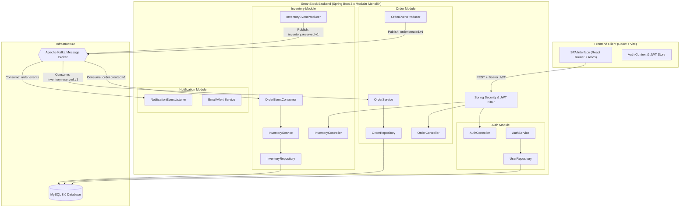
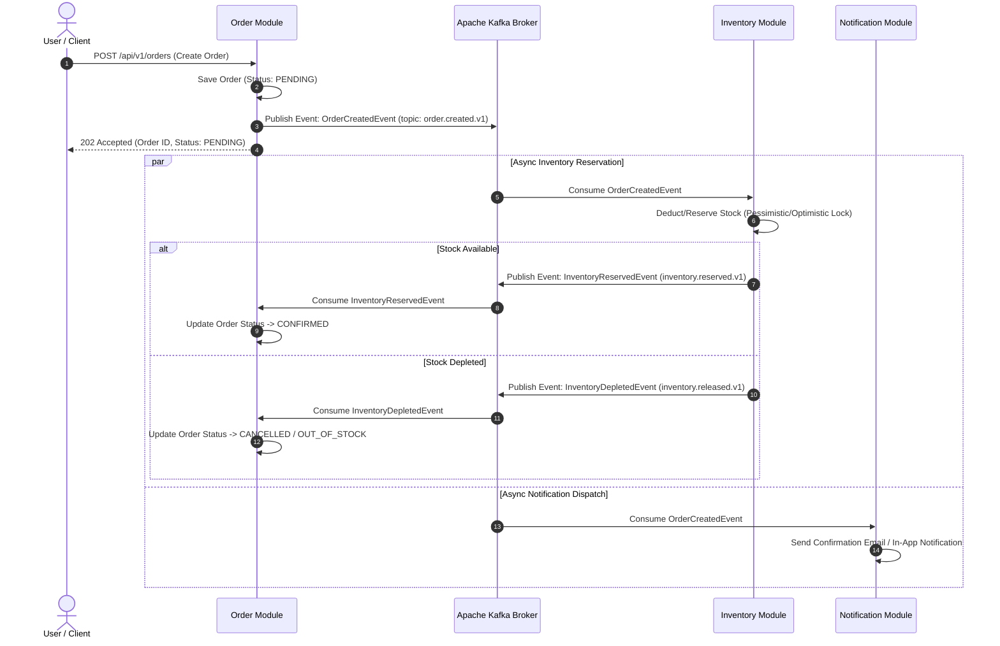

# SmartStock System Architecture

## 1. Architectural Philosophy: The Modular Monolith

SmartStock is architected as a **Modular Monolith** with **Event-Driven Processing**.

### Why Modular Monolith instead of Microservices?
A frequent misconception in software engineering interviews is that large or scalable systems must always start as microservices. In reality, premature decomposition into microservices introduces:
- Distributed transactions and network latency.
- High operational overhead (service meshes, distributed tracing, complex CI/CD).
- Network boundary serialization costs.
- Difficult data consistency across distinct databases.

The **Modular Monolith** provides the optimal balance:
1. **Strict Logical Boundaries:** Each domain module (`auth`, `inventory`, `order`, `notification`) encapsulates its own domain entities, business rules, and repository contracts.
2. **In-Process Communication:** Modules call each other via clear Java interfaces without network hops.
3. **Single Deployable Unit:** Simplified testing, local development, and unified zero-downtime deployment.
4. **Future-Proof Decomposition:** Because modules maintain clean boundaries with zero hidden coupling, any module can be extracted into an independent microservice in the future if organizational scaling demands it.

---

## 2. System Architecture Diagram

---

## 3. Domain Modules & Bounded Contexts

Each module is isolated under `com.smartstock.modules.<module_name>`:

| Module | Core Responsibility | Communication Style |
| :--- | :--- | :--- |
| **`auth`** | User registration, authentication, RBAC, JWT generation and validation | Synchronous (REST / Filter) |
| **`inventory`** | Product catalog, real-time stock levels, warehouse allocation, safety stock thresholds | Sync (REST query) + Async (Kafka reservation) |
| **`order`** | Order submission, pricing calculations, status state machine | Sync (REST submission) + Async (Kafka dispatch) |
| **`notification`** | Real-time audit, email alerts, customer order status notifications | Asynchronous (Kafka listener) |
| **`common`** | Shared cross-cutting concerns: security filters, global exception handlers, base events | Internal library |

### Rules for Module Decoupling:
- **No direct entity references across modules:** An `Order` entity must store `productId` as a value type/foreign reference, rather than owning a JPA `@ManyToOne Product` association.
- **Independent schema tables:** Each module owns its designated tables (`users`, `products`, `orders`). No cross-module database foreign key cascades.
- **Asynchronous business handoffs:** High-throughput state transitions (e.g., checkout -> stock reservation) pass through Kafka events.

---

## 4. Event-Driven Workflow with Apache Kafka

SmartStock leverages Apache Kafka to decouple the checkout transaction from inventory locking and notification dispatching.

### Kafka Topics Strategy

1. **`order.created.v1`**
   - **Key:** `orderId` (ensures partition ordering per order)
   - **Payload:** Order details, customer ID, item list with SKU & quantity.
2. **`inventory.reserved.v1`**
   - **Key:** `orderId`
   - **Payload:** Reservation confirmation, allocated warehouse ID, timestamp.
3. **`inventory.released.v1`**
   - **Key:** `orderId`
   - **Payload:** Release/failure reason, affected SKUs.

---

## 5. Security & Authentication Architecture

- **Stateless Authentication:** Spring Security does not maintain HTTP sessions (`SessionCreationPolicy.STATELESS`).
- **JWT (JSON Web Token):** Generated using JJWT (HMAC-SHA256 with 256-bit+ secure secret).
- **Request Flow:**
  1. Client sends credentials to `/api/v1/auth/login`.
  2. Spring Security authenticates against `UserRepository` with `BCryptPasswordEncoder`.
  3. Server signs and returns JWT.
  4. Client stores JWT in memory / browser storage and sends `Authorization: Bearer <token>` in Axios headers.
  5. `JwtAuthenticationFilter` validates token signature and sets the `SecurityContextHolder`.

---

## 6. Interview Talking Points for Placements

When discussing this architecture in placement interviews, highlight:
1. **Modular Monolith vs Microservices:** Explain why you didn't over-engineer with microservices from Day 1, saving DevOps overhead while preserving clean boundaries.
2. **Eventual Consistency:** Explain how order processing uses Kafka events to achieve high throughput without distributed lock bottlenecks.
3. **Idempotency:** How consumers handle duplicate Kafka messages safely using unique `eventId` or order status checks.
4. **Resilience:** If the Inventory consumer goes down, messages safely accumulate in Kafka without dropping customer orders.
