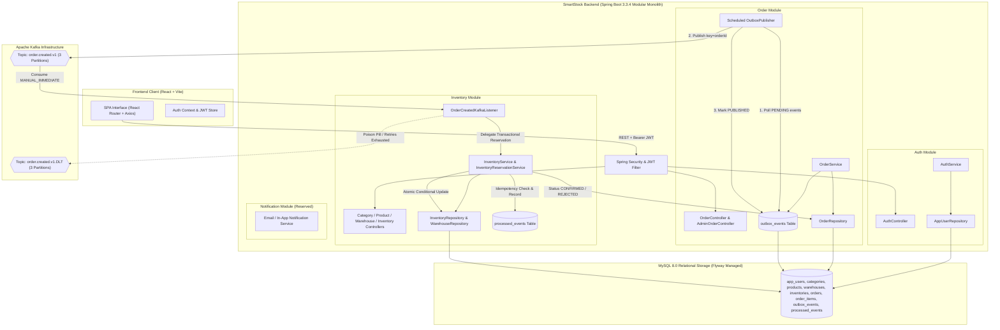
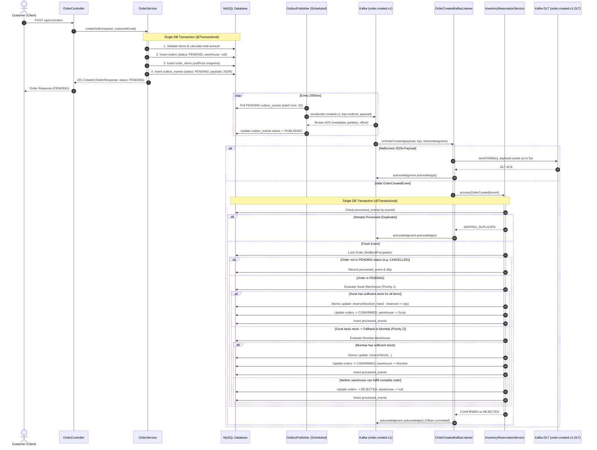
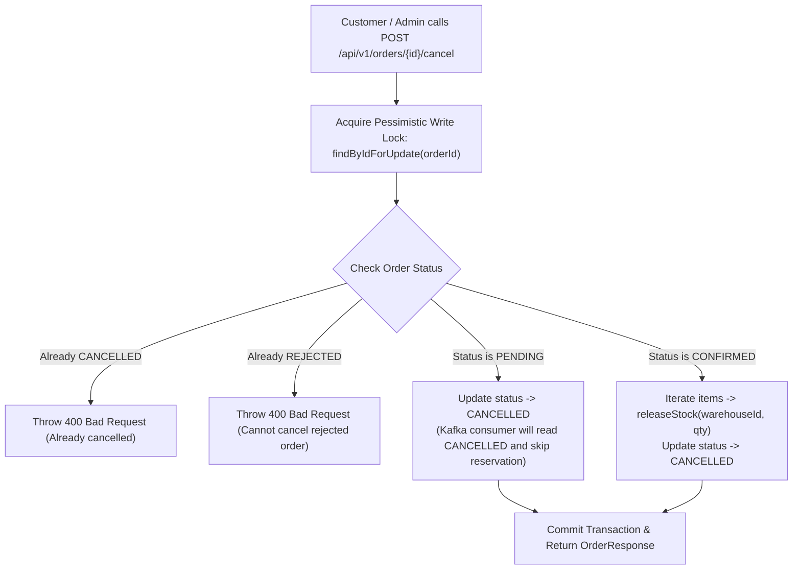

# SmartStock System Architecture

## 1. Architectural Philosophy: The Modular Monolith

SmartStock is architected as an **Event-Driven Modular Monolith**.

### Why Modular Monolith instead of Microservices?
In production software engineering and technical interviews, an essential principle is avoiding premature distributed systems complexity. Decomposing into microservices too early introduces:
- Distributed transactions (2PC / Saga overhead) and cross-network latency.
- High operational surface area (service discovery, distributed tracing, network failure modes).
- Data fragmentation across distinct databases.

The **Modular Monolith** provides the optimal balance:
1. **Strict Domain Boundaries:** Each domain feature module (`auth`, `inventory`, `order`, `notification`) encapsulates its own entities, DTOs, business rules, and repository contracts.
2. **ACID Transaction Guarantees:** Modules operate within a unified relational database, enabling bulletproof patterns like the **Transactional Outbox**.
3. **Decoupled Asynchronous Processing:** High-contention operations (e.g. order reservation) are processed asynchronously via Apache Kafka.
4. **Clean Extraction Path:** Because modules have zero hidden coupling, any module can be separated into an independent microservice when business scale warrants it.

---

## 2. System Architecture & Module Map



---

## 3. End-to-End Order Processing Flow

The core workflow employs the **Transactional Outbox Pattern** to achieve guaranteed event publishing without distributed transactions:



---

## 4. Key Architectural Deep Dives

### 4.1. Concurrency Safety: Atomic Conditional SQL Updates
To prevent inventory overselling under high concurrency, SmartStock does not rely on application-level locks. Instead, it utilizes database row-level locking via atomic conditional updates:

```sql
UPDATE inventories
SET reserved = reserved + :quantity,
    version = version + 1,
    updated_at = CURRENT_TIMESTAMP
WHERE product_id = :productId
  AND warehouse_id = :warehouseId
  AND (on_hand - reserved) >= :quantity;
```

- If `(on_hand - reserved) >= :quantity` evaluates to true, exactly **1 row** is updated.
- If concurrent transactions consume stock, the row count is **0**, indicating the stock was claimed.
- No phantom reads, negative stock, or overselling is possible.

### 4.2. All-or-Nothing Multi-Item Reservation
An order is never split across warehouses.
1. When evaluating a candidate warehouse, each item is reserved sequentially.
2. If item 1 succeeds but item 2 fails:
   - All earlier reserved items at that warehouse are released via `releaseStock()` before evaluating the next warehouse.
   - If compensation fails (`released != 1`), an `IllegalStateException` is thrown immediately, rolling back the database transaction and aborting evaluation of subsequent warehouses.

### 4.3. Safe Order Cancellation
SmartStock allows customers and administrators to cancel orders safely:


### 4.4. Kafka Reliability, Retries & Dead Letter Topic (DLT)
- **Container Acknowledgment Mode:** `AckMode.MANUAL_IMMEDIATE`. Offsets are committed **only after** the database transaction completes.
- **Error Handling:** `DefaultErrorHandler` configured with `FixedBackOff(1000L, 3L)` (3 retries).
- **Poison Pill Isolation:** Malformed JSON and deserialization errors are classified as non-retryable and routed directly to `order.created.v1.DLT` via synchronous publication (`future.get(5, TimeUnit.SECONDS)`) before acknowledging the offset, preventing partition blocking.
- **Duplicate Delivery Absorption:** If duplicate messages race concurrently, the unique constraint on `processed_events.event_id` raises a `DataIntegrityViolationException`. The listener verifies event presence via `isEventProcessed(eventId)` in a fresh read-only transaction and acknowledges the duplicate cleanly.

---

## 5. Security & RBAC Architecture

- **Stateless JWT:** Bearer token authentication via JJWT (HMAC-SHA256 with 256-bit+ secret).
- **Password Hashing:** BCrypt with default strength (10 rounds).
- **Role-Based Access Control:**
  - `CUSTOMER`: Can place orders, view their own order history (`GET /api/v1/orders`), view their own order details (`GET /api/v1/orders/{id}`), and cancel their own orders.
  - `ADMIN`: Full administrative control, including paginated order exploration (`GET /api/v1/admin/orders`), catalog management, warehouse setup, and inventory adjustments.
- **IDOR Protection:** Ownership validation ensures customers can never inspect or cancel another customer's orders.
- **Data Protection:** Generic internal exception messages are sanitized to prevent database error or stack trace leakage in 500 responses.
