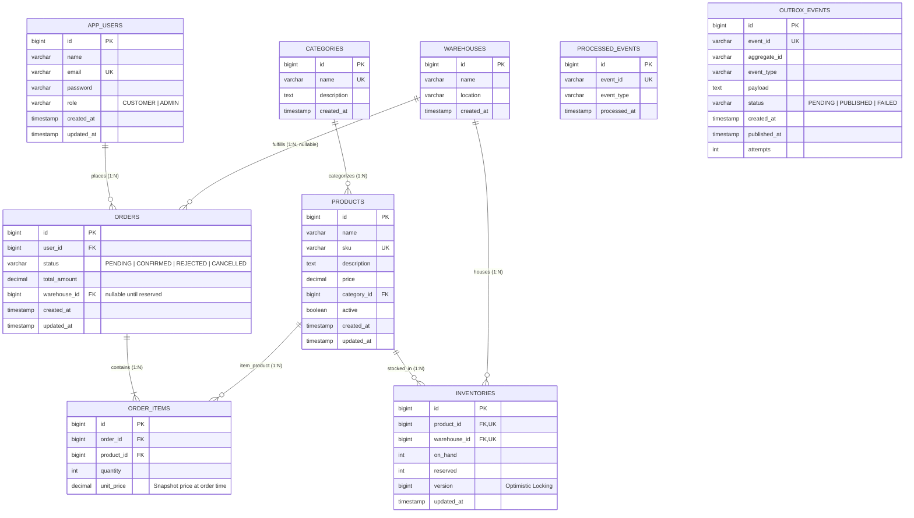
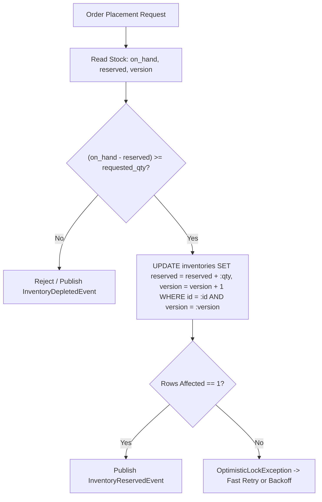

# SmartStock Database Design & Data Modeling

## 1. Storage Philosophy

SmartStock operates on a single MySQL 8.0 relational database instance supporting a **Modular Monolith** architecture with **Event-Driven Order Processing**.

Key principles:
- **Flyway-Led Schema Management:** All database schema changes are strictly version-controlled through Flyway migration scripts (`src/main/resources/db/migration/V1__initial_schema.sql`).
- **Hibernate Schema Validation:** `spring.jpa.hibernate.ddl-auto` is set to `validate`. Hibernate never modifies database tables at runtime; it validates that JPA entity mappings strictly match the underlying schema.
- **Relational Integrity:** Foreign keys enforce referential integrity across modules while avoiding cascading deletes across aggregate roots (cascading deletes are strictly restricted to `orders -> order_items`).
- **Auditability & Concurrency:** Core domain tables include timestamp auditing (`created_at`, `updated_at`). High-contention inventory tables employ optimistic locking (`version`).
- **Idempotency & Reliability:** Dedicated tables for the Transactional Outbox pattern (`outbox_events`) and Kafka consumer deduplication (`processed_events`).

---

## 2. Entity-Relationship Diagram (ERD)

---

## 3. Detailed Specifications for the Nine Tables

### 1. `app_users` (Authentication & Identity Module)
Stores customer and administrator profiles, credentials, and roles.

| Column | Type | Constraints | Description |
| :--- | :--- | :--- | :--- |
| `id` | `BIGINT AUTO_INCREMENT` | `PRIMARY KEY` | Unique user identifier |
| `name` | `VARCHAR(100)` | `NOT NULL` | Full name of the user |
| `email` | `VARCHAR(150)` | `NOT NULL, UNIQUE` | Unique login email |
| `password` | `VARCHAR(255)` | `NOT NULL` | BCrypt-hashed password |
| `role` | `VARCHAR(20)` | `NOT NULL` | Role: `CUSTOMER`, `ADMIN` |
| `created_at` | `TIMESTAMP` | `NOT NULL, DEFAULT CURRENT_TIMESTAMP` | Account creation timestamp |
| `updated_at` | `TIMESTAMP` | `NOT NULL, DEFAULT CURRENT_TIMESTAMP` | Last profile update timestamp |

---

### 2. `categories` (Inventory Module)
Product hierarchy and groupings for catalog organization.

| Column | Type | Constraints | Description |
| :--- | :--- | :--- | :--- |
| `id` | `BIGINT AUTO_INCREMENT` | `PRIMARY KEY` | Category identifier |
| `name` | `VARCHAR(100)` | `NOT NULL, UNIQUE` | Unique category name |
| `description` | `TEXT` | `NULL` | Optional category description |
| `created_at` | `TIMESTAMP` | `NOT NULL, DEFAULT CURRENT_TIMESTAMP` | Creation timestamp |

---

### 3. `products` (Inventory Module)
Master product catalog containing SKUs, descriptions, and current listing prices.

| Column | Type | Constraints | Description |
| :--- | :--- | :--- | :--- |
| `id` | `BIGINT AUTO_INCREMENT` | `PRIMARY KEY` | Unique product identifier |
| `name` | `VARCHAR(150)` | `NOT NULL` | Product commercial name |
| `sku` | `VARCHAR(50)` | `NOT NULL, UNIQUE` | Stock Keeping Unit |
| `description` | `TEXT` | `NULL` | Specifications & details |
| `price` | `DECIMAL(12, 2)` | `NOT NULL, CHECK (price >= 0)` | Current catalog price |
| `category_id` | `BIGINT` | `NOT NULL, FK to categories(id)` | Associated category |
| `active` | `BOOLEAN` | `NOT NULL, DEFAULT TRUE` | Active/inactive visibility flag |
| `created_at` | `TIMESTAMP` | `NOT NULL, DEFAULT CURRENT_TIMESTAMP` | Creation timestamp |
| `updated_at` | `TIMESTAMP` | `NOT NULL, DEFAULT CURRENT_TIMESTAMP` | Last updated timestamp |

---

### 4. `warehouses` (Inventory Module)
Physical warehouse locations where physical stock is maintained.

| Column | Type | Constraints | Description |
| :--- | :--- | :--- | :--- |
| `id` | `BIGINT AUTO_INCREMENT` | `PRIMARY KEY` | Warehouse identifier |
| `name` | `VARCHAR(100)` | `NOT NULL` | Warehouse name |
| `location` | `VARCHAR(200)` | `NOT NULL` | City, address, or geographic hub |
| `created_at` | `TIMESTAMP` | `NOT NULL, DEFAULT CURRENT_TIMESTAMP` | Facility registration timestamp |

---

### 5. `inventories` (Inventory Module)
Tracks multi-warehouse stock levels for products. Models the Many-to-Many relationship between `products` and `warehouses`.

| Column | Type | Constraints | Description |
| :--- | :--- | :--- | :--- |
| `id` | `BIGINT AUTO_INCREMENT` | `PRIMARY KEY` | Inventory record identifier |
| `product_id` | `BIGINT` | `NOT NULL, FK to products(id)` | Associated product |
| `warehouse_id` | `BIGINT` | `NOT NULL, FK to warehouses(id)` | Associated warehouse |
| `on_hand` | `INT` | `NOT NULL, DEFAULT 0, CHECK (on_hand >= 0)` | Total physical units in warehouse |
| `reserved` | `INT` | `NOT NULL, DEFAULT 0, CHECK (reserved >= 0)` | Units locked for pending orders |
| `version` | `BIGINT` | `NOT NULL, DEFAULT 0` | JPA `@Version` optimistic locking counter |
| `updated_at` | `TIMESTAMP` | `NOT NULL, DEFAULT CURRENT_TIMESTAMP` | Last stock adjustment timestamp |

> [!IMPORTANT]
> **Stock Calculation Rule:** Available stock is strictly computed as:
> $$\text{available} = \text{on\_hand} - \text{reserved}$$
> To prevent synchronization drift and anomalies, `available` is **not** stored as a separate database column. It is exposed dynamically in the `Inventory` entity via `getAvailable()`.
> 
> **Integrity Constraint:** An explicit check constraint `chk_inventories_reserved_on_hand` enforces `reserved <= on_hand` at the database level.
> 
> **Uniqueness:** A composite unique constraint `uk_inventories_product_warehouse (product_id, warehouse_id)` ensures a product appears at most once per warehouse.

---

### 6. `orders` (Order Module)
Tracks customer purchase orders and their lifecycle state machine.

| Column | Type | Constraints | Description |
| :--- | :--- | :--- | :--- |
| `id` | `BIGINT AUTO_INCREMENT` | `PRIMARY KEY` | Internal order identifier |
| `user_id` | `BIGINT` | `NOT NULL, FK to app_users(id)` | Customer placing the order |
| `status` | `VARCHAR(20)` | `NOT NULL` | `PENDING`, `CONFIRMED`, `REJECTED`, `CANCELLED` |
| `total_amount` | `DECIMAL(12, 2)` | `NOT NULL, DEFAULT 0.00, CHECK (total_amount >= 0)` | Order monetary total |
| `warehouse_id` | `BIGINT` | `NULL, FK to warehouses(id)` | Warehouse allocated for fulfillment |
| `created_at` | `TIMESTAMP` | `NOT NULL, DEFAULT CURRENT_TIMESTAMP` | Order placement timestamp |
| `updated_at` | `TIMESTAMP` | `NOT NULL, DEFAULT CURRENT_TIMESTAMP` | State transition timestamp |

> [!NOTE]
> `warehouse_id` is intentionally nullable upon initial order creation (`PENDING`). It is populated once the asynchronous Kafka inventory reservation listener resolves the optimal warehouse facility.

---

### 7. `order_items` (Order Module)
Itemized lines within an order.

| Column | Type | Constraints | Description |
| :--- | :--- | :--- | :--- |
| `id` | `BIGINT AUTO_INCREMENT` | `PRIMARY KEY` | Line item identifier |
| `order_id` | `BIGINT` | `NOT NULL, FK to orders(id) ON DELETE CASCADE` | Associated order |
| `product_id` | `BIGINT` | `NOT NULL, FK to products(id)` | Purchased product |
| `quantity` | `INT` | `NOT NULL, CHECK (quantity > 0)` | Number of units ordered |
| `unit_price` | `DECIMAL(12, 2)` | `NOT NULL, CHECK (unit_price >= 0)` | Snapshot price at checkout time |

> [!IMPORTANT]
> `unit_price` captures the exact price snapshot at checkout time. Future price adjustments in `products.price` do not alter historical order line items or invoices.

---

### 8. `processed_events` (Common Event Module)
Provides consumer idempotency for Kafka event processing.

| Column | Type | Constraints | Description |
| :--- | :--- | :--- | :--- |
| `id` | `BIGINT AUTO_INCREMENT` | `PRIMARY KEY` | Record identifier |
| `event_id` | `VARCHAR(100)` | `NOT NULL, UNIQUE` | Unique Kafka event UUID |
| `event_type` | `VARCHAR(100)` | `NOT NULL` | Class or type of event (e.g. `OrderCreatedEvent`) |
| `processed_at` | `TIMESTAMP` | `NOT NULL, DEFAULT CURRENT_TIMESTAMP` | Timestamp of successful consumption |

---

### 9. `outbox_events` (Common Event Module)
Implements the Transactional Outbox pattern to guarantee at-least-once message delivery to Kafka without distributed two-phase commit transactions.

| Column | Type | Constraints | Description |
| :--- | :--- | :--- | :--- |
| `id` | `BIGINT AUTO_INCREMENT` | `PRIMARY KEY` | Outbox record identifier |
| `event_id` | `VARCHAR(36)` | `NOT NULL, UNIQUE` | UUID identifying the event |
| `aggregate_id` | `VARCHAR(100)` | `NOT NULL` | ID of domain aggregate root (e.g., `order_id`) |
| `event_type` | `VARCHAR(100)` | `NOT NULL` | Domain event type name |
| `payload` | `TEXT` | `NOT NULL` | Serialized JSON event body |
| `status` | `VARCHAR(20)` | `NOT NULL, DEFAULT 'PENDING'` | State: `PENDING`, `PUBLISHED`, `FAILED` |
| `created_at` | `TIMESTAMP` | `NOT NULL, DEFAULT CURRENT_TIMESTAMP` | Transaction creation timestamp |
| `published_at` | `TIMESTAMP` | `NULL` | Kafka dispatch timestamp |
| `attempts` | `INT` | `NOT NULL, DEFAULT 0` | Dispatch retry counter |

---

## 4. Database Constraints & Indexing Strategy

### A. Constraints Summary

| Constraint Name | Table | Type | Expression / Target Columns |
| :--- | :--- | :--- | :--- |
| `PRIMARY KEY` | All 9 tables | PK | `id` (`BIGINT AUTO_INCREMENT`) |
| `uk_app_users_email` | `app_users` | Unique | `email` |
| `uk_categories_name` | `categories` | Unique | `name` |
| `uk_products_sku` | `products` | Unique | `sku` |
| `uk_inventories_product_warehouse` | `inventories` | Unique | `(product_id, warehouse_id)` |
| `uk_processed_events_event_id` | `processed_events` | Unique | `event_id` |
| `uk_outbox_events_event_id` | `outbox_events` | Unique | `event_id` |
| `chk_products_price` | `products` | Check | `price >= 0` |
| `chk_inventories_on_hand` | `inventories` | Check | `on_hand >= 0` |
| `chk_inventories_reserved` | `inventories` | Check | `reserved >= 0` |
| `chk_inventories_reserved_on_hand` | `inventories` | Check | `reserved <= on_hand` |
| `chk_orders_total_amount` | `orders` | Check | `total_amount >= 0` |
| `chk_order_items_quantity` | `order_items` | Check | `quantity > 0` |
| `chk_order_items_unit_price` | `order_items` | Check | `unit_price >= 0` |

### B. Indexes Summary

| Index Name | Table | Target Columns | Purpose |
| :--- | :--- | :--- | :--- |
| `idx_products_category_id` | `products` | `category_id` | Fast product lookups by category |
| `idx_products_sku` | `products` | `sku` | Point lookups during barcode / checkout scans |
| `idx_inventories_product_id` | `inventories` | `product_id` | Stock queries for a given product |
| `idx_inventories_warehouse_id`| `inventories` | `warehouse_id` | Stock audits for a specific warehouse |
| `idx_orders_user_id` | `orders` | `user_id` | Customer order history lookups |
| `idx_orders_status` | `orders` | `status` | Operational dashboards filtering pending/confirmed orders |
| `idx_orders_warehouse_id` | `orders` | `warehouse_id` | Fulfillment queues per warehouse |
| `idx_order_items_order_id` | `order_items` | `order_id` | Retrieving itemized lines for an order |
| `idx_order_items_product_id` | `order_items` | `product_id` | Finding order history for a product |
| `idx_processed_events_event_id`| `processed_events` | `event_id` | Low-latency idempotency checks in Kafka listeners |
| `idx_outbox_events_status` | `outbox_events` | `status` | High-frequency polling of `PENDING` outbox records |
| `idx_outbox_events_event_id` | `outbox_events` | `event_id` | Outbox lookups by event UUID |

---

## 5. Concurrency & Locking Strategy

During flash-sale conditions, multiple customer transactions may compete for available stock of the same product. SmartStock uses a layered concurrency model:

1. **Optimistic Locking (`@Version`):**
   - Implemented via `inventories.version`.
   - Hibernate automatically includes `WHERE version = :version` on updates.
   - If a concurrent transaction modified stock first, Hibernate throws `OptimisticLockException`, preventing race conditions and phantom over-allocations.
2. **Database Check Constraints:**
   - Even in edge cases where application-level locks are bypassed, MySQL enforces `chk_inventories_reserved_on_hand` (`reserved <= on_hand`), guaranteeing negative stock is physically impossible at the storage engine level.
