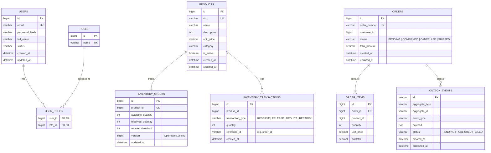

# SmartStock Database Design & Data Modeling

## 1. Storage Philosophy

SmartStock operates on a single MySQL 8.0 relational database instance while enforcing **logical domain isolation** across modules. 

Key principles:
- **Zero Cross-Module Hard Foreign Keys:** While internal module relationships (e.g., `orders` to `order_items`) use relational foreign keys with cascading options, tables from different bounded contexts (e.g., `orders` referencing `products`) maintain loose coupling by referencing IDs only as indexed scalar columns (`product_id BIGINT`).
- **Data Integrity:** Handled by ACID transactions within individual module operations and eventual consistency via Kafka events across boundaries.
- **Auditability:** Core tables include standard audit fields (`created_at`, `updated_at`, `version`).

---

## 2. Entity-Relationship Diagram (ERD)



---

## 3. Detailed Table Specifications

### A. Authentication Module

#### `users`
| Column | Type | Constraints | Description |
| :--- | :--- | :--- | :--- |
| `id` | `BIGINT AUTO_INCREMENT` | `PRIMARY KEY` | Unique user identifier |
| `email` | `VARCHAR(150)` | `NOT NULL, UNIQUE` | User login email |
| `password_hash` | `VARCHAR(255)` | `NOT NULL` | BCrypt encrypted password hash |
| `full_name` | `VARCHAR(100)` | `NOT NULL` | Display name |
| `status` | `VARCHAR(30)` | `NOT NULL, DEFAULT 'ACTIVE'` | Account status (`ACTIVE`, `SUSPENDED`) |
| `created_at` | `DATETIME(6)` | `NOT NULL` | Audit timestamp |
| `updated_at` | `DATETIME(6)` | `NOT NULL` | Audit timestamp |

#### `roles` & `user_roles`
Standard RBAC supporting roles such as `ROLE_ADMIN`, `ROLE_WAREHOUSE_MANAGER`, `ROLE_CUSTOMER`.

---

### B. Inventory Module

#### `products`
| Column | Type | Constraints | Description |
| :--- | :--- | :--- | :--- |
| `id` | `BIGINT AUTO_INCREMENT` | `PRIMARY KEY` | Product ID |
| `sku` | `VARCHAR(60)` | `NOT NULL, UNIQUE` | Stock Keeping Unit |
| `name` | `VARCHAR(200)` | `NOT NULL` | Product name |
| `description` | `TEXT` | `NULL` | Product specifications |
| `unit_price` | `DECIMAL(12, 2)` | `NOT NULL` | Current selling price |
| `category` | `VARCHAR(60)` | `NOT NULL` | Classification category |
| `is_active` | `BOOLEAN` | `NOT NULL, DEFAULT TRUE` | Soft-deletion flag |
| `created_at` | `DATETIME(6)` | `NOT NULL` | Creation timestamp |
| `updated_at` | `DATETIME(6)` | `NOT NULL` | Last modification timestamp |

#### `inventory_stocks`
| Column | Type | Constraints | Description |
| :--- | :--- | :--- | :--- |
| `id` | `BIGINT AUTO_INCREMENT` | `PRIMARY KEY` | Record identifier |
| `product_id` | `BIGINT` | `NOT NULL, UNIQUE` | Reference to product |
| `available_quantity` | `INT` | `NOT NULL, CHECK (>= 0)` | Stock ready for reservation |
| `reserved_quantity` | `INT` | `NOT NULL, CHECK (>= 0)` | Stock held for pending orders |
| `reorder_threshold` | `INT` | `NOT NULL, DEFAULT 10` | Low stock notification limit |
| `version` | `BIGINT` | `NOT NULL, DEFAULT 0` | JPA `@Version` optimistic lock counter |
| `updated_at` | `DATETIME(6)` | `NOT NULL` | Last stock adjustment timestamp |

#### `inventory_transactions`
Audit log recording every stock change with trace identifiers (e.g. which order caused deduction).

---

### C. Order Module

#### `orders`
| Column | Type | Constraints | Description |
| :--- | :--- | :--- | :--- |
| `id` | `BIGINT AUTO_INCREMENT` | `PRIMARY KEY` | Internal ID |
| `order_number` | `VARCHAR(64)` | `NOT NULL, UNIQUE` | Public tracking number (e.g., `ORD-20261108-XYZ`) |
| `customer_id` | `BIGINT` | `NOT NULL` | Reference to `users.id` |
| `status` | `VARCHAR(40)` | `NOT NULL` | State: `PENDING`, `CONFIRMED`, `CANCELLED`, `COMPLETED` |
| `total_amount` | `DECIMAL(12, 2)` | `NOT NULL` | Aggregated total price |
| `created_at` | `DATETIME(6)` | `NOT NULL` | Timestamp |
| `updated_at` | `DATETIME(6)` | `NOT NULL` | Timestamp |

#### `order_items`
| Column | Type | Constraints | Description |
| :--- | :--- | :--- | :--- |
| `id` | `BIGINT AUTO_INCREMENT` | `PRIMARY KEY` | Line item identifier |
| `order_id` | `BIGINT` | `NOT NULL, FK to orders(id)` | Order association |
| `product_id` | `BIGINT` | `NOT NULL` | Product identifier reference |
| `quantity` | `INT` | `NOT NULL, CHECK (> 0)` | Quantity ordered |
| `unit_price` | `DECIMAL(12, 2)` | `NOT NULL` | Snapshot price at checkout time |
| `subtotal` | `DECIMAL(12, 2)` | `NOT NULL` | `quantity * unit_price` |

---

### D. Event Infrastructure (Transactional Outbox Pattern)

#### `outbox_events`
Solves the dual-write problem (writing to DB and publishing to Kafka reliably).
| Column | Type | Constraints | Description |
| :--- | :--- | :--- | :--- |
| `id` | `VARCHAR(36)` | `PRIMARY KEY` | UUID event ID |
| `aggregate_type` | `VARCHAR(80)` | `NOT NULL` | E.g. `Order`, `Inventory` |
| `aggregate_id` | `VARCHAR(80)` | `NOT NULL` | Primary entity ID |
| `event_type` | `VARCHAR(100)` | `NOT NULL` | E.g. `OrderCreatedEvent` |
| `payload` | `JSON` | `NOT NULL` | Full serialized event payload |
| `status` | `VARCHAR(20)` | `NOT NULL` | `PENDING`, `PUBLISHED`, `FAILED` |
| `created_at` | `DATETIME(6)` | `NOT NULL` | Event creation timestamp |
| `published_at` | `DATETIME(6)` | `NULL` | Kafka dispatch confirmation timestamp |

---

## 4. Concurrency & Race Condition Strategy

During high-concurrency order surges (e.g., flash sales), multiple requests may attempt to reserve stock for the same SKU simultaneously.

### Strategy Comparison for Interviews:

1. **Optimistic Locking (`@Version`):**
   - Implemented via `version` column in `inventory_stocks`.
   - Before updating: `UPDATE inventory_stocks SET available_quantity = available_quantity - :qty, version = version + 1 WHERE id = :id AND version = :version`.
   - **Best for:** Read-heavy catalogs with low-to-medium contention. Fails fast with `OptimisticLockException` which can trigger retries.

2. **Pessimistic Locking (`SELECT ... FOR UPDATE`):**
   - Implemented via Spring Data JPA `@Lock(LockModeType.PESSIMISTIC_WRITE)`.
   - Acquires row-level exclusive lock in MySQL InnoDB.
   - **Best for:** Extremely high contention items where retries would waste resources.

3. **Atomic Database Decrement:**
   ```sql
   UPDATE inventory_stocks
   SET available_quantity = available_quantity - :qty,
       reserved_quantity = reserved_quantity + :qty
   WHERE product_id = :productId AND available_quantity >= :qty;
   ```
   - Checks inventory directly in the database lock without keeping transactions open. Returns rows affected (`1` = success, `0` = out of stock).

---

## 5. Indexing & Optimization Strategy

- **`products.sku`:** Unique B-Tree index for instant SKU lookup during barcode scanning and inventory lookups.
- **`inventory_stocks.product_id`:** Unique index ensuring 1:1 stock record per product.
- **`orders(customer_id, created_at DESC)`:** Composite index for retrieving a user's recent order history.
- **`orders(status)`:** Filter index for operational dashboards finding pending orders.
- **`outbox_events(status, created_at)`:** Composite index allowing outbox poller to quickly fetch pending events in batch.
