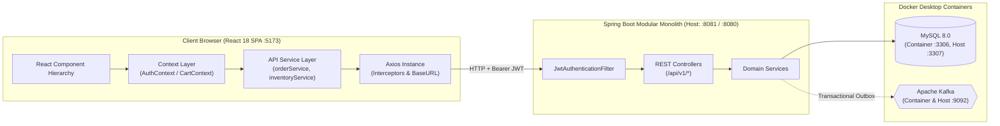
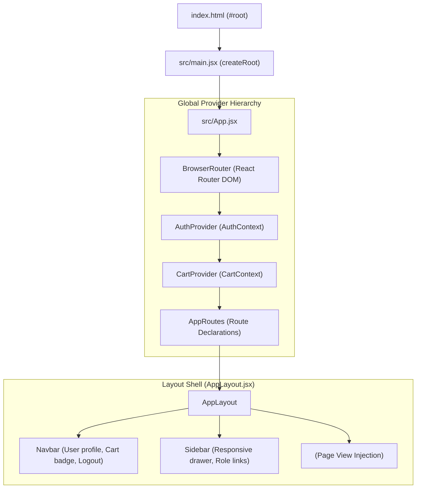
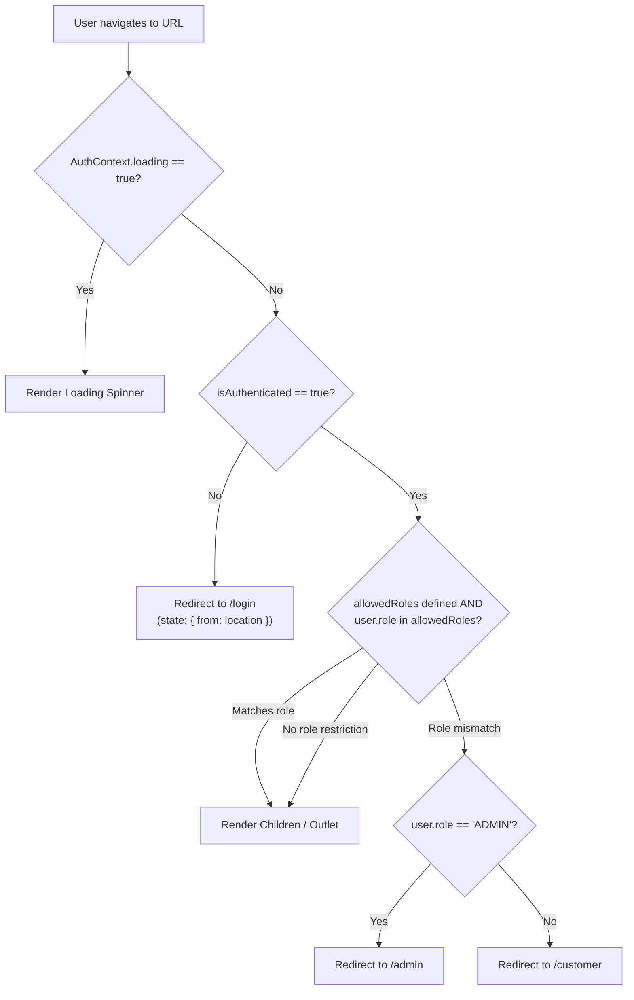
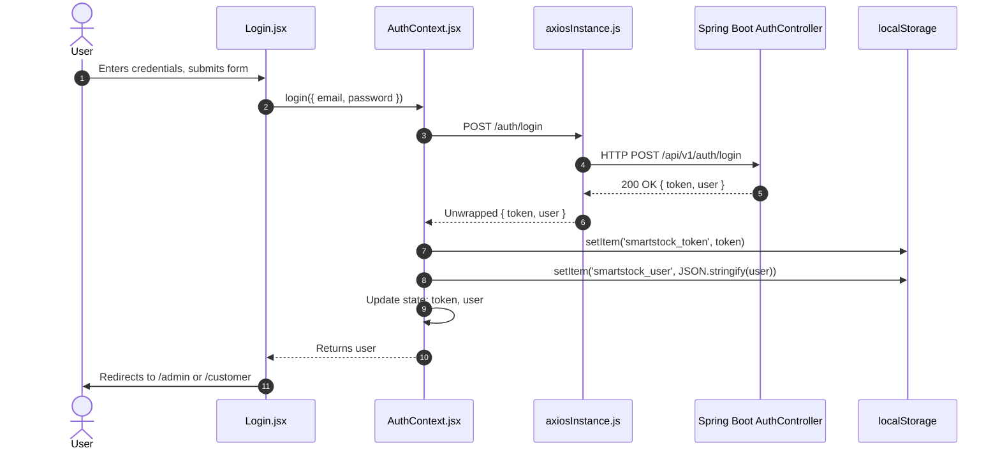

# SmartStock Frontend Architecture & Engineering Guide

> **Technical Reference & Architectural Reviewer Guide**  
> **Target Audience:** Frontend Engineers, Full-Stack Developers, Technical Mentors, and Engineering Interview Candidates.  
> **Repository Context:** `smartstock-frontend`  
> **Companion Guide:** [BACKEND_GUIDE.md](../backend/BACKEND_GUIDE.md)  
> **Tech Stack:** React 18.3.1, Vite 5.4.8, Tailwind CSS 4.3.5, React Router DOM 6.27.0, Axios 1.7.7  

---

## Table of Contents

1. [SmartStock Frontend Overview](#1-smartstock-frontend-overview)
2. [Project Structure & Directory Architecture](#2-project-structure--directory-architecture)
3. [JavaScript (ES2022+) Fundamentals in SmartStock](#3-javascript-es2022-fundamentals-in-smartstock)
4. [React Fundamentals: From First Principles to Implementation](#4-react-fundamentals-from-first-principles-to-implementation)
5. [React Application Architecture & Component Hierarchy](#5-react-application-architecture--component-hierarchy)
6. [React Router & Client-Side Navigation](#6-react-router--client-side-navigation)
7. [State Management & React Context API](#7-state-management--react-context-api)
8. [API Integration with Axios & Service Layer](#8-api-integration-with-axios--service-layer)
9. [Authentication Lifecycle & Security Architecture](#9-authentication-lifecycle--security-architecture)
10. [Customer Portal Deep Dive](#10-customer-portal-deep-dive)
11. [Admin Operations Console Deep Dive](#11-admin-operations-console-deep-dive)
12. [Forms, Field-Level Validation, and User Experience](#12-forms-field-level-validation-and-user-experience)
13. [Tailwind CSS 4 & Design System Tokens](#13-tailwind-css-4--design-system-tokens)
14. [10 End-to-End Enterprise Workflows](#14-10-end-to-end-enterprise-workflows)
15. [Error Handling, HTTP Resilience & Frontend Security](#15-error-handling-http-resilience--frontend-security)
16. [Performance Optimization & Code Quality](#16-performance-optimization--code-quality)
17. [Frontend Testing Strategy & Production Build Workflow](#17-frontend-testing-strategy--production-build-workflow)
18. [Architectural Decisions & Engineering Trade-offs](#18-architectural-decisions--engineering-trade-offs)
19. [Genuine Limitations & Production Roadmap](#19-genuine-limitations--production-roadmap)
20. [50+ Frontend & Full-Stack Interview Questions & Answers](#20-50-frontend--full-stack-interview-questions--answers)
21. [Interview Pitch, Technical Deep Dive & Resume Points](#21-interview-pitch-technical-deep-dive--resume-points)

---

# 1. SmartStock Frontend Overview

### What SmartStock Frontend Does
SmartStock's frontend is a single-page application (SPA) built with React 18 and Vite. It interfaces with an enterprise inventory and event-driven order processing Spring Boot backend, serving two distinct personas:

1. **Customer Portal:** Enables end-users to register, authenticate, browse an active catalog of SKUs, filter by category and search queries, manage a persistent shopping cart, submit orders, and track order fulfillment status via an on-demand status tracker.
2. **Admin Operations Console:** Empowers operations personnel and platform administrators to monitor platform KPIs, inspect global order streams, execute administrative order cancellations with role attribution, manage catalog SKUs and taxonomy, configure regional warehouse distribution centers, and execute inventory adjustments with real-time constraint validation.

### Real-World Business Context
In e-commerce and logistics platforms, inventory reservations during checkout are decoupled from order creation to prevent database connection pool exhaustion and overselling. When a customer checks out in SmartStock, the backend commits an order in a `PENDING` state and writes a domain event to an outbox table for publication to Apache Kafka (`order.created.v1`). The frontend manages this asynchronous workflow by displaying clear lifecycle states (`PENDING` $\to$ `CONFIRMED` / `REJECTED` / `CANCELLED`), providing an interactive manual "Check Status Update" button to query order fulfillment outcomes, and displaying attribution when an order is cancelled by an administrator versus the customer.

### Technology Stack & Rationale

| Technology | Version | Purpose in SmartStock | Why Selected Over Alternatives |
| :--- | :--- | :--- | :--- |
| **React** | `18.3.1` | Core UI library for declarative, component-driven interfaces. | Component model separates reusable atomic UI controls (`Button`, `Input`, `Badge`) from domain modules (`OrderStatusTracker`, `ProductCard`). Concurrent rendering features support smooth interface updates. |
| **Vite** | `5.4.8` | Build tool and local development server. | Fast cold starts via native ES modules in development and optimized Rollup bundling for production builds. |
| **Tailwind CSS** | `4.3.5` | Utility-first CSS framework via `@tailwindcss/vite`. | Rapid UI styling with deterministic utility classes, avoiding stylesheet bloat. Zero-runtime CSS extraction ensures high runtime performance. |
| **React Router DOM** | `6.27.0` | Client-side routing and navigation. | Enables nested routing layouts (`AppLayout`), route guard wrappers (`ProtectedRoute`), and browser history synchronization without full page reloads. |
| **Axios** | `1.7.7` | Promise-based HTTP client for browser communication. | Built-in support for request/response interceptors, automatic JSON serialization/deserialization, configurable timeouts (10s), and centralized JWT Bearer token injection. |

### Frontend-Backend Communication Architecture & Ports

The React frontend communicates exclusively over HTTP/REST with the Spring Boot backend. The browser **never** connects directly to MySQL or Kafka; all database operations and Kafka interactions are mediated by the Spring Boot backend.

#### Port & URL Configuration
* **Spring Boot Backend Port:** Default is `8080` (as defined in `application.yml` and `.env.example`). In the local development environment (`backend/.env`), this is configured to `SERVER_PORT=8081` to avoid local port conflicts.
* **Frontend API Base URL:** Configured via `VITE_API_BASE_URL` in `frontend/.env` (`http://localhost:8081/api/v1`), with `http://localhost:8080/api/v1` in `frontend/.env.example`. [axiosInstance.js](src/api/axiosInstance.js) includes a fallback to `http://localhost:8081/api/v1`.
* **Container-Internal vs. Host-Mapped Ports:** In Docker Compose, MySQL runs on container port `3306` but is mapped to host port `3307` (`"${MYSQL_PORT:-3307}:3306"`). The host Spring Boot process connects to `localhost:3307`. Kafka runs on port `9092`.



Every backend endpoint returns a standardized response envelope:
```json
{
  "success": true,
  "message": "Operation completed successfully",
  "data": { ... },
  "timestamp": "2026-11-14T17:00:00"
}
```
The frontend Axios client response interceptor unwraps `response.data` so that components consume raw domain objects directly.

---

# 2. Project Structure & Directory Architecture

The frontend is structured in a feature-oriented pattern that separates presentation, state, API networking, and utilities:

```
frontend/
├── index.html                           # Single-page application HTML entrypoint
├── package.json                         # Dependencies and npm script definitions
├── vite.config.js                       # Vite build configuration with Tailwind plugin
├── .env                                 # Local development environment variables
├── .env.example                         # Template for required environment variables
├── src/
│   ├── main.jsx                         # Application bootstrapping and React DOM rendering
│   ├── App.jsx                          # Root provider configuration (Auth, Cart, Router)
│   ├── index.css                        # Global CSS entrypoint (@import "tailwindcss")
│   ├── App.css                          # App-level styling rules
│   │
│   ├── api/                             # Network and API client layer
│   │   ├── endpoints.js                 # Centralized dictionary of backend API paths
│   │   ├── axiosInstance.js             # Configured Axios instance with interceptors
│   │   ├── axiosClient.js               # Secondary client reference for compatibility
│   │   ├── authService.js               # Authentication endpoints (login, register, me)
│   │   ├── productService.js            # Product catalog CRUD endpoints
│   │   ├── categoryService.js           # Category taxonomy CRUD endpoints
│   │   ├── warehouseService.js          # Distribution hub endpoints
│   │   ├── inventoryService.js          # Stock level and adjustment endpoints
│   │   ├── orderService.js              # Order placement, tracking, and cancellation
│   │   └── dashboardService.js          # System metrics and KPI endpoints
│   │
│   ├── assets/                          # Static assets and SVG icons
│   │   └── logo.svg                     # SmartStock platform branding logo
│   │
│   ├── components/                      # Reusable React UI components
│   │   ├── ProtectedRoute.jsx           # Role-based route guard and access controller
│   │   ├── Navbar.jsx                   # Root navigation re-export
│   │   ├── admin/
│   │   │   └── AdminNavTabs.jsx         # Sub-navigation bar for Admin console modules
│   │   ├── common/                      # Atomic design system components
│   │   │   ├── Badge.jsx                # Status badges (success, warning, danger, neutral)
│   │   │   ├── Button.jsx               # Styled buttons with variant and size matrices
│   │   │   ├── Card.jsx                 # Structured card container with header and action
│   │   │   ├── ConfirmationModal.jsx    # Modal dialog for confirmation of actions
│   │   │   ├── Input.jsx                # Form input field with validation error display
│   │   │   └── StatCard.jsx             # Key performance indicator (KPI) metric card
│   │   ├── layout/                      # Structural application shell components
│   │   │   ├── AppLayout.jsx            # Master layout wrapping Navbar, Sidebar, Outlet
│   │   │   ├── Navbar.jsx               # Header bar with user profile, cart pill, logout
│   │   │   └── Sidebar.jsx              # Responsive navigation drawer with role-based links
│   │   ├── orders/                      # Domain-specific order components
│   │   │   └── OrderStatusTracker.jsx   # Visual status tracker for order lifecycle
│   │   └── products/                    # Domain-specific product components
│   │       ├── ProductCard.jsx          # Catalog item card with stock badge and add-to-cart
│   │       ├── ProductDetailsModal.jsx  # Modal showing SKU specs and stock status
│   │       ├── ProductFilterBar.jsx     # Search bar, category dropdown, stock status filter
│   │       └── ProductSkeleton.jsx      # Animated pulse skeleton for loading states
│   │
│   ├── context/                         # Global application state providers
│   │   ├── AuthContext.jsx              # JWT token, user identity, login/logout, /auth/me
│   │   └── CartContext.jsx              # Shopping cart items, quantities, totals, localStorage
│   │
│   ├── hooks/                           # Custom React hook abstractions
│   │   ├── useAuth.js                   # Convenience hook consuming AuthContext
│   │   └── useCart.js                   # Convenience hook consuming CartContext
│   │
│   ├── pages/                           # Top-level route views
│   │   ├── Dashboard.jsx                # Universal operations hub (role-adaptive view)
│   │   ├── Inventory.jsx                # Route dispatcher for inventory management
│   │   ├── Login.jsx                    # Root login page wrapper
│   │   ├── NotFound.jsx                 # 404 fallback page
│   │   ├── Orders.jsx                   # Customer order history page
│   │   ├── admin/                       # Admin-exclusive console views
│   │   │   ├── AdminCategories.jsx      # Category taxonomy management
│   │   │   ├── AdminDashboard.jsx       # Global KPI metrics and order feed
│   │   │   ├── AdminInventory.jsx       # Warehouse stock levels and atomic adjustment modal
│   │   │   ├── AdminOrders.jsx          # Paginated order list with admin cancellation
│   │   │   ├── AdminProducts.jsx        # Product catalog CRUD with soft deactivation
│   │   │   └── AdminWarehouses.jsx      # Regional distribution center management
│   │   ├── auth/                        # Authentication views
│   │   │   ├── Login.jsx                # Interactive credentials login form
│   │   │   └── Register.jsx             # New customer registration form
│   │   └── customer/                    # Customer-exclusive views
│   │       ├── Cart.jsx                 # Shopping cart inspection and item removal
│   │       ├── Checkout.jsx             # Order confirmation and submission
│   │       ├── CustomerDashboard.jsx    # Customer home view with recent orders
│   │       ├── OrderDetail.jsx          # Detailed order breakdown with OrderStatusTracker
│   │       └── Products.jsx             # Public customer product catalog
│   │
│   ├── routes/                          # Routing configuration
│   │   └── AppRoutes.jsx                # Declarative route hierarchy and route guards
│   │
│   └── utils/                           # Pure JavaScript helper functions
│       └── formatters.js                # Currency (INR) and date formatting helpers
```

---

# 3. JavaScript (ES2022+) Fundamentals in SmartStock

### 1. ES Modules (Named vs. Default Exports)
SmartStock utilizes:
* **Default Exports** for components and pages:
  ```javascript
  // src/components/common/Button.jsx
  export default function Button({ children, ...props }) { ... }
  ```
* **Named Exports** for services, utilities, and endpoints:
  ```javascript
  // src/api/orderService.js
  export const getOrderById = async (id) => { ... };
  export const cancelOrder = async (id) => { ... };
  ```

### 2. Arrow Functions
Used for concise function declarations and lexical scope handling:
```javascript
// src/utils/formatters.js
export const formatCurrency = (amount, currency = 'INR') => {
  if (amount === undefined || amount === null || isNaN(amount)) return '₹0.00';
  return new Intl.NumberFormat('en-IN', {
    style: 'currency',
    currency: 'INR',
    maximumFractionDigits: 2,
  }).format(amount);
};
```

### 3. Destructuring Assignment (Objects & Arrays)
Used across components and hooks:
* **Props Destructuring:**
  ```javascript
  // src/components/common/Card.jsx
  export default function Card({ title, subtitle, action, children, className = '' }) { ... }
  ```
* **Hook State Destructuring:**
  ```javascript
  const [products, setProducts] = useState([]);
  ```

### 4. Spread (`...`) and Rest Operators
* **State Immutability via Spread:**
  ```javascript
  // src/pages/auth/Register.jsx
  setFormData((prev) => ({ ...prev, [field]: value }));
  ```
* **Attribute Forwarding via Rest:**
  ```javascript
  // src/components/common/Input.jsx
  export default function Input({ label, error, helperText, id, ...props }) {
    return <input id={id} {...props} />;
  }
  ```

### 5. Array Methods (`map`, `filter`, `reduce`)
* **`map` for List Rendering:** Rendering table rows and cards.
* **`filter` for In-Memory Filtering:** Filtering products by category and active status.
* **`reduce` for Totals:** Calculating cart quantity and price subtotals in `CartContext.jsx`.

### 6. Promises, Async/Await & Try/Catch
Asynchronous API calls use `async/await` inside `try...catch...finally` blocks to manage loading states:
```javascript
// src/pages/customer/Products.jsx
const loadCatalog = async () => {
  setLoading(true);
  setError(null);
  try {
    const [productsData, categoriesData] = await Promise.all([
      getProducts(),
      getCategories(),
    ]);
    setProducts(productsData);
    setCategories(categoriesData);
  } catch (err) {
    setError(err?.message || 'Failed to load products');
  } finally {
    setLoading(false);
  }
};
```

### 7. Optional Chaining (`?.`) & Nullish Coalescing (`??`)
Prevents runtime exceptions when accessing nested API data:
```javascript
const originPath = location.state?.from?.pathname;
const errorMsg = err?.message ?? 'An unexpected error occurred';
```

### 8. Web Storage API (`localStorage`)
Stores user sessions and shopping cart data across browser refreshes:
```javascript
localStorage.setItem('smartstock_token', token);
localStorage.setItem('smartstock_cart', JSON.stringify(cartItems));
```

---

# 4. React Fundamentals: From First Principles to Implementation

### 1. Declarative UI & The Virtual DOM
In vanilla JavaScript, DOM updates are imperative (`el.innerText = count`). In React, interfaces are declared as a function of state. When state changes, React computes the diff between the previous and new Virtual DOM trees (reconciliation) and updates only the necessary browser DOM nodes.

### 2. Functional Components & Modern JSX Compilation
In modern React (React 17+) and Vite (via `@vitejs/plugin-react`), JSX is transformed using the **modern JSX transform** (`react/jsx-runtime`). JSX expressions compile into calls to `_jsx()` or `_jsxs()`, rather than the legacy `React.createElement()` syntax:
```jsx
// JSX Source
<Button variant="primary">Submit</Button>

// Modern Transpiled Output (Babel / Rollup)
import { jsx as _jsx } from 'react/jsx-runtime';
_jsx(Button, { variant: 'primary', children: 'Submit' });
```
Because of this transform, `import React from 'react'` is not required solely for JSX syntax.

### 3. Component Props & Unidirectional Data Flow
Props flow downward from parent to child. In [ProductCard.jsx](src/components/products/ProductCard.jsx):
```jsx
export default function ProductCard({
  product,
  onAddToCart,
  onViewDetails,
  isInCart = false,
  cartQuantity = 0,
}) {
  // Receives data and callbacks via props; does not modify state directly.
}
```

### 4. Component State (`useState`)
`useState` preserves values between re-renders. In [Login.jsx](src/pages/auth/Login.jsx):
```javascript
const [email, setEmail] = useState('');                   // User-entered email
const [password, setPassword] = useState('');             // User-entered password
const [isSubmitting, setIsSubmitting] = useState(false);   // Loading state
const [errorMessage, setErrorMessage] = useState('');     // API error message
const [fieldErrors, setFieldErrors] = useState({});       // Field validation error map
```

### 5. Side Effects (`useEffect`) & StrictMode Development Behavior
`useEffect` synchronizes components with external systems (API calls, storage, subscriptions).

> [!NOTE]
> **React StrictMode Development Behavior:**
> In local development mode (`src/main.jsx` wraps `<App />` in `<React.StrictMode>`), React intentionally **mounts, unmounts, and re-mounts components**, executing effect setup $\to$ cleanup $\to$ setup twice on initial render.
> This behavior helps developers identify missing cleanup functions and unexpected side effects. In production builds, effects run only once on mount.

In [AuthContext.jsx](src/context/AuthContext.jsx):
```javascript
useEffect(() => {
  const initAuth = async () => {
    const savedToken = localStorage.getItem('smartstock_token');
    const savedUser = localStorage.getItem('smartstock_user');

    if (savedToken) {
      setToken(savedToken);
      if (savedUser) {
        try {
          setUser(JSON.parse(savedUser));
        } catch (e) {
          console.error('Failed to parse cached user', e);
        }
      }

      try {
        const currentUser = await getCurrentUser();
        setUser(currentUser);
        localStorage.setItem('smartstock_user', JSON.stringify(currentUser));
      } catch (err) {
        localStorage.removeItem('smartstock_token');
        localStorage.removeItem('smartstock_user');
        setToken(null);
        setUser(null);
      }
    }
    setLoading(false);
  };

  initAuth();
}, []); // Empty array: runs on mount (twice in dev under StrictMode, once in production)
```

### 6. Controlled Components & Form Inputs
Form inputs in SmartStock are controlled components whose values are driven by state. In [Input.jsx](src/components/common/Input.jsx):
```jsx
<input
  id={id}
  type={type}
  value={value}
  onChange={onChange}
  className={...}
  {...props}
/>
```

---

# 5. React Application Architecture & Component Hierarchy

### Application Entry Point & Provider Tree
1. `index.html` loads `<div id="root"></div>` and executes `/src/main.jsx`.
2. [main.jsx](src/main.jsx) calls `ReactDOM.createRoot()` and renders `<App />` inside `React.StrictMode`.
3. [App.jsx](src/App.jsx) establishes the provider tree:



### Reusable UI Component Matrix

| Component | Path | Purpose | Key Props |
| :--- | :--- | :--- | :--- |
| **`Button`** | [Button.jsx](src/components/common/Button.jsx) | Button with variants and sizes | `variant`, `size`, `disabled`, `onClick` |
| **`Input`** | [Input.jsx](src/components/common/Input.jsx) | Form input with error label | `label`, `error`, `helperText`, `value`, `onChange` |
| **`Badge`** | [Badge.jsx](src/components/common/Badge.jsx) | Status indicator tag | `variant` (`success`, `warning`, `danger`, `neutral`, `primary`) |
| **`Card`** | [Card.jsx](src/components/common/Card.jsx) | Structured container panel | `title`, `subtitle`, `action`, `children` |
| **`StatCard`** | [StatCard.jsx](src/components/common/StatCard.jsx) | KPI metric card | `title`, `value`, `subtext`, `icon`, `badge` |
| **`ConfirmationModal`** | [ConfirmationModal.jsx](src/components/common/ConfirmationModal.jsx) | Confirmation dialog | `isOpen`, `title`, `message`, `onConfirm`, `onClose`, `isLoading` |

---

# 6. React Router & Client-Side Navigation

### Route Guard Architecture ([ProtectedRoute.jsx](src/components/ProtectedRoute.jsx))
Enforces three sequential checks:
1. **Loading Check:** While verifying a cached token via `/auth/me`, renders a loading spinner.
2. **Authentication Check:** If unauthenticated, redirects to `/login` with `state: { from: location }`.
3. **Role Authorization Check:** If `allowedRoles` are specified (e.g. `['ADMIN']`) and the user's role does not match, redirects to the user's authorized portal (`/admin` or `/customer`).



### Route Map Summary
* **Public Routes:** `/login`, `/register`.
* **Universal Routes (inside `AppLayout`):** `/` (Operations Dashboard), `/products` (Catalog), `/inventory` (Dispatcher).
* **Customer Protected (`allowedRoles=['CUSTOMER']`):** `/customer`, `/cart`, `/checkout`, `/orders`, `/orders/:orderId`.
* **Admin Protected (`allowedRoles=['ADMIN']`):** `/admin`, `/admin/orders`, `/admin/products`, `/admin/categories`, `/admin/warehouses`, `/admin/inventory`.
* **Fallback Route:** `*` $\to$ `<NotFound />`.

---

# 7. State Management & React Context API

SmartStock manages global state using React Context rather than external libraries:
* **`AuthContext.jsx`:** Stores `user`, `token`, `loading`, `isAuthenticated`, `isAdmin`, `isCustomer`, and authentication functions (`login`, `register`, `logout`).
* **`CartContext.jsx`:** Stores `cartItems` and synchronizes with `localStorage` (`smartstock_cart`).
* **Derived Cart Metrics via `useMemo`:**
  ```javascript
  const totalItems = useMemo(
    () => cartItems.reduce((sum, item) => sum + item.quantity, 0),
    [cartItems]
  );

  const cartSubtotal = useMemo(
    () => cartItems.reduce((sum, item) => sum + (item.product.price * item.quantity), 0),
    [cartItems]
  );
  ```

---

# 8. API Integration with Axios & Service Layer

### Centralized Axios Configuration ([axiosInstance.js](src/api/axiosInstance.js))
* **Base URL:** Reads `import.meta.env.VITE_API_BASE_URL` with fallback to `http://localhost:8081/api/v1`.
* **Timeout:** `10000ms` (10 seconds).
* **Request Interceptor:** Injects `Authorization: Bearer <token>` from `localStorage`.
* **Response Interceptor:** Returns `response.data` (unwrapping the standard response envelope). Intercepts HTTP 401s to clear storage and redirect protected routes to `/login`.
* **No Automatic Retries:** Axios is **not** configured with automatic retry logic (no `axios-retry`). Failed network requests reject immediately and are handled by component catch blocks.

### Service Layer Directory

| Service | File | Key Methods |
| :--- | :--- | :--- |
| **Auth** | [authService.js](src/api/authService.js) | `loginUser()`, `registerUser()`, `getCurrentUser()` |
| **Products** | [productService.js](src/api/productService.js) | `getProducts()`, `getProductById()`, `createProduct()`, `updateProduct()`, `deactivateProduct()` |
| **Categories** | [categoryService.js](src/api/categoryService.js) | `getCategories()`, `createCategory()`, `updateCategory()`, `deleteCategory()` |
| **Warehouses** | [warehouseService.js](src/api/warehouseService.js) | `getAllWarehouses()`, `createWarehouse()`, `updateWarehouse()` |
| **Inventory** | [inventoryService.js](src/api/inventoryService.js) | `getAllInventory()`, `getInventoryByWarehouse()`, `adjustStock()` |
| **Orders** | [orderService.js](src/api/orderService.js) | `createOrder()`, `getMyOrders()`, `getOrderById()`, `cancelOrder()`, `getAllOrdersAdmin()`, `cancelOrderAdmin()` |
| **Dashboard** | [dashboardService.js](src/api/dashboardService.js) | `getPlatformMetrics()` |

---

# 9. Authentication Lifecycle & Security Architecture

### Sequence Diagram: Login Flow



---

# 10. Customer Portal Deep Dive

### 1. Product Catalog ([Products.jsx](src/pages/customer/Products.jsx))
* Concurrently fetches products and categories via `Promise.all([getProducts(), getCategories()])`.
* Filters catalog in-memory using `useMemo` based on category, search text, and stock filter.
* Shows [ProductSkeleton.jsx](src/components/products/ProductSkeleton.jsx) while data is loading.

### 2. Shopping Cart ([Cart.jsx](src/pages/customer/Cart.jsx))
* Displays line items with quantity adjustments (`+`, `-`) and removal controls.
* Changes sync immediately with `localStorage` via `CartContext`.

### 3. Checkout ([Checkout.jsx](src/pages/customer/Checkout.jsx))
* Maps cart items to `OrderCreateRequest` format: `{ items: [{ productId, quantity }] }`.
* Submits via `POST /api/v1/orders`. On HTTP 201 (`PENDING`), clears the cart and navigates to the order details page.

### 4. Order Tracking ([OrderStatusTracker.jsx](src/components/orders/OrderStatusTracker.jsx))
* **Visual Status Pipeline:** Renders order states: Placed (`PENDING`) $\to$ Stock Allocation $\to$ Final Status (`CONFIRMED`, `REJECTED`, `CANCELLED`).
* **On-Demand Manual Status Refresh:** Provides an interactive "Check Status Update" button that invokes `getOrderById(orderId)`. The application does **not** use automated background polling, WebSockets, or Server-Sent Events; the user clicks to check for Kafka allocation updates.
* **Actor Role Attribution:** Displays whether a cancellation was executed by `CUSTOMER` or `ADMIN`.

---

# 11. Admin Operations Console Deep Dive

### 1. Admin Dashboard ([AdminDashboard.jsx](src/pages/admin/AdminDashboard.jsx))
Displays system KPI cards, recent platform orders, and warehouse inventory summaries.

### 2. Order Management & Cancellation ([AdminOrders.jsx](src/pages/admin/AdminOrders.jsx))
* Lists paginated orders with status tabs (`ALL`, `PENDING`, `CONFIRMED`, `REJECTED`, `CANCELLED`).
* Executes administrative order cancellation via `POST /api/v1/admin/orders/{id}/cancel` (with modal confirmation).

### 3. Inventory & Stock Adjustments ([AdminInventory.jsx](src/pages/admin/AdminInventory.jsx))
* Displays on-hand, reserved, and available stock levels across distribution centers.
* **Stock Adjustment Modal:** Allows administrators to adjust on-hand stock via `POST /api/v1/inventory/adjust`. Previews calculated available stock and enforces `newOnHand >= currentReserved`.

### 4. Product Catalog CRUD ([AdminProducts.jsx](src/pages/admin/AdminProducts.jsx))
* Allows creating and editing products. SKU is required and uppercase on creation, and locked (`disabled`) during edit.
* Soft-deactivates products via `DELETE /api/v1/products/{id}`.

### 5. Categories ([AdminCategories.jsx](src/pages/admin/AdminCategories.jsx)) & Warehouses ([AdminWarehouses.jsx](src/pages/admin/AdminWarehouses.jsx))
* Manages category taxonomy and regional distribution centers.
* Warns against deleting categories containing active products. Explains why warehouse deletion is omitted to protect relational integrity.

---

# 12. Forms, Field-Level Validation, and User Experience

SmartStock combines client-side checks with backend validation error mapping:
1. **Client-Side Checks:** Non-empty checks, minimum length, and password match validation before submission.
2. **Server-Side Validation Mapping:** When Spring Boot's `@Valid` fails, the backend returns HTTP 400 with a map of field error messages in `ApiResponse.data`. Form catch blocks map these errors into `fieldErrors` state to display red error messages under the corresponding inputs:
   ```javascript
   catch (err) {
     if (err?.data && typeof err.data === 'object') {
       setFieldErrors(err.data);
     }
     setErrorMessage(err?.message || 'Submission failed');
   }
   ```
3. **Clearing Errors on Input:** Input `onChange` handlers clear field-specific errors as soon as the user modifies the field.

---

# 13. Tailwind CSS 4 & Design System Tokens

SmartStock uses **Tailwind CSS 4.3.5** integrated via `@tailwindcss/vite` without legacy config files.

### Global CSS ([index.css](src/index.css))
```css
@import "tailwindcss";

@layer base {
  body {
    @apply bg-slate-50 text-slate-900 font-sans antialiased;
  }
}
```

### Semantic Color Matrix
* **Slate:** Backgrounds, borders (`border-slate-200`), text.
* **Indigo:** Primary brand buttons, active tabs, focus rings.
* **Emerald:** Success states, `CONFIRMED` orders, `IN_STOCK` items.
* **Amber:** Warnings, `PENDING` orders, `LOW_STOCK` items.
* **Rose:** Error banners, `REJECTED` orders, `OUT_OF_STOCK` items.

---

# 14. 10 End-to-End Enterprise Workflows

1. **Customer Registration:** User submits form $\to$ `POST /api/v1/auth/register` $\to$ Token stored in `localStorage` $\to$ Redirect to `/customer`.
2. **Customer Login:** User enters credentials $\to$ `POST /api/v1/auth/login` $\to$ Token stored $\to$ Redirect based on role (`/admin` or `/customer`).
3. **Browsing Catalog:** Mounts `/products` $\to$ `Promise.all` fetches products and categories $\to$ In-memory filtering via `useMemo`.
4. **Cart Management:** User clicks "Add to Cart" $\to$ `CartContext.addToCart` updates items $\to$ Syncs to `localStorage` (`smartstock_cart`).
5. **Checkout Submission:** Cart mapped to `{ items }` $\to$ `POST /api/v1/orders` $\to$ Backend returns HTTP 201 (`PENDING`) $\to$ Cart cleared $\to$ Navigate to `/orders/:id`.
6. **Order Status Tracking:** User views order $\to$ Clicks "Check Status Update" $\to$ `GET /api/v1/orders/:id` $\to$ Displays updated status (`CONFIRMED` or `REJECTED`).
7. **Customer Cancellation:** User clicks "Cancel Order" on confirmed order $\to$ `POST /api/v1/orders/:id/cancel` $\to$ Backend releases reserved stock and records `cancelledByRole = 'CUSTOMER'`.
8. **Admin Stock Adjustment:** Admin opens adjustment modal $\to$ Validates `newOnHand >= reserved` $\to$ `POST /api/v1/inventory/adjust` $\to$ Updates table row in local state.
9. **Admin Product CRUD:** Admin creates product $\to$ `POST /api/v1/products` $\to$ Later deactivates via `DELETE /api/v1/products/:id` (soft deletion).
10. **Admin Order Cancellation:** Admin cancels order from console $\to$ `POST /api/v1/admin/orders/:id/cancel` $\to$ Backend releases stock and records `cancelledByRole = 'ADMIN'`.

---

# 15. Error Handling, HTTP Resilience & Frontend Security

### Frontend Security Nuances
* **LocalStorage JWT Trade-Offs:** Storing JWTs in `localStorage` persists sessions across browser tabs and avoids server-side session state. However, data in `localStorage` is accessible to JavaScript running in the same origin. If an XSS vulnerability exists, stored tokens can be exfiltrated.
* **CSRF Mitigation via Authorization Header:** Because the JWT is attached manually via the `Authorization: Bearer <token>` header in Axios request interceptors, browsers do not automatically send the token on cross-origin requests. This mitigates classic cookie-based Cross-Site Request Forgery (CSRF).
* **XSS Nuances in React:** React escapes string values inserted into JSX text nodes and attribute expressions, which prevents basic HTML injection attacks. However, React does **not** prevent all XSS vulnerabilities:
  * User-controlled URLs passed to `<a href={userUrl}>` can execute script via `javascript:` pseudo-protocols.
  * Direct DOM manipulation via `ref.current.innerHTML` bypasses React's escaping.
  * Compromised third-party npm dependencies or unvetted scripts can read `localStorage`.

### Financial Value Representation
Prices are formatted in Indian Rupees using `Intl.NumberFormat('en-IN', { style: 'currency', currency: 'INR' })` in [formatters.js](src/utils/formatters.js) to avoid floating-point display inaccuracies.

---

# 16. Performance Optimization & Code Quality

### Code Optimization Analysis
* **`useMemo` Usage:**
  * In [CartContext.jsx](src/context/CartContext.jsx): Memoizes `totalItems` and `cartSubtotal`.
  * In [Products.jsx](src/pages/customer/Products.jsx) and [AdminProducts.jsx](src/pages/admin/AdminProducts.jsx): Memoizes filtered product lists based on search, category, and status filters.
  * In [AdminCategories.jsx](src/pages/admin/AdminCategories.jsx): Memoizes product count mapping per category.
  * In [AdminWarehouses.jsx](src/pages/admin/AdminWarehouses.jsx): Memoizes aggregated warehouse inventory totals.
* **`useCallback` Usage:**
  * In [Products.jsx](src/pages/customer/Products.jsx), [AdminProducts.jsx](src/pages/admin/AdminProducts.jsx), [AdminCategories.jsx](src/pages/admin/AdminCategories.jsx), [AdminWarehouses.jsx](src/pages/admin/AdminWarehouses.jsx), and [Dashboard.jsx](src/pages/Dashboard.jsx): Wraps data-fetching functions to maintain stable references for `useEffect` dependencies.
* **Skeleton Screens:** [ProductSkeleton.jsx](src/components/products/ProductSkeleton.jsx) displays placeholder cards during data fetching.

---

# 17. Frontend Testing Strategy & Production Build Workflow

### Testing Reality in Current Codebase
Inspection of [package.json](package.json) shows:
```json
"scripts": {
  "dev": "vite",
  "build": "vite build",
  "preview": "vite preview"
}
```
> [!IMPORTANT]
> **No Automated Test Runner:** The frontend currently does **not** have an automated test suite configured (no Vitest, Jest, Cypress, or React Testing Library dependencies). Testing is currently performed via manual verification.

### Production Build Workflow
Running `npm run build`:
1. Executes `vite build`. Note: It does **not** run ESLint (ESLint is not configured in `package.json`).
2. Rollup bundles JavaScript modules, eliminating unused exports via tree-shaking.
3. Tailwind CSS 4 compiles and minifies utility classes into a static CSS file.
4. Output assets are written to the `dist/` directory with content hashes for browser caching.

---

# 18. Architectural Decisions & Engineering Trade-offs

| Decision | Selected Choice | Alternative Considered | Trade-Off & Justification |
| :--- | :--- | :--- | :--- |
| **State Management** | React Context API | Redux Toolkit / Zustand | Avoids external dependencies and boilerplate for an application with two global domains (Auth and Cart). |
| **Routing** | React Router DOM v6 | Next.js / Hash Routing | Standard client-side SPA routing; SSR is unnecessary for an authenticated operations portal. |
| **HTTP Client** | Axios | Native `fetch()` | Interceptors provide centralized token injection and 401 handling; handles JSON parsing and timeout aborts automatically. |
| **Styling** | Tailwind CSS 4 | CSS Modules / Styled-Components | Zero-runtime CSS extraction with atomic utility classes. |
| **Status Updates** | Manual Refresh Button | WebSockets / SSE | Keeps backend simple without managing persistent WebSocket connection state; acceptable for low-frequency status checks. |

---

# 19. Genuine Limitations & Production Roadmap

### Implemented Realities vs. Proposed Features

| Area | Current Implementation | Proposed Roadmap Feature |
| :--- | :--- | :--- |
| **Order Status Updates** | Manual "Check Status Update" button | Real-time push notifications via WebSockets (STOMP) or Server-Sent Events (SSE). |
| **Cart Storage** | Stored in browser `localStorage` (`smartstock_cart`) | Server-side cart entity synced across devices. |
| **Automated Testing** | None (manual testing only) | Vitest for unit/hook tests; React Testing Library for component interactions; Playwright for E2E tests. |
| **Token Refresh** | Session expires when 24-hour token expires | Silent refresh token rotation using HTTP-only cookies. |
| **Admin Pagination** | Products and categories tables filter in-memory | Server-side Spring Data pagination across all admin endpoints. |

---

# 20. 50+ Frontend & Full-Stack Interview Questions & Answers

### Category 1: React Fundamentals (Q1–Q5)

#### Q1: What is the Virtual DOM and how does reconciliation work?
**Answer:** The Virtual DOM is an in-memory representation of the real DOM. When state changes, React builds a new Virtual DOM tree and diffs it against the previous tree using a heuristic reconciliation algorithm. It updates only the modified browser DOM nodes, minimizing expensive browser reflows.

#### Q2: How does modern JSX compilation work in React 17+ and Vite?
**Answer:** In React 17+ and modern Vite builds, JSX compiles via the modern JSX transform (`react/jsx-runtime`) into `_jsx()` or `_jsxs()` function calls. It does not compile to `React.createElement()`, and `import React from 'react'` is not required simply to write JSX.

#### Q3: What is the difference between props and state?
**Answer:** Props are read-only inputs passed from a parent component down to a child. State is internal, mutable data managed within a component via `useState` that triggers a re-render when updated.

#### Q4: Why must React state be updated immutably?
**Answer:** React performs shallow reference equality checks (`Object.is`) to determine if state has changed. Mutating state directly modifies the existing reference, causing React to miss the update and skip re-rendering. Creating new references (e.g. `[...prev, newItem]`) ensures changes are detected.

#### Q5: What is the purpose of keys in React lists?
**Answer:** Keys give elements a stable identity across renders so React can track which items were added, removed, or reordered during reconciliation. Using array indexes as keys can cause rendering bugs and state issues when list items are reordered or removed.

---

### Category 2: Hooks & Lifecycle (Q6–Q10)

#### Q6: Why do effects run twice in React 18 during development?
**Answer:** When wrapped in `<React.StrictMode>`, React 18 intentionally mounts, unmounts, and re-mounts components in development mode to verify that effect cleanups properly reset side effects and subscriptions. In production, effects run only once on mount.

#### Q7: What are the differences between `useEffect` dependency array options?
**Answer:**
* Omitted: Runs after every render.
* Empty `[]`: Runs once after initial mount and cleans up on unmount.
* Populated `[dep1, dep2]`: Runs on mount and whenever any dependency reference changes.

#### Q8: When should you use `useMemo` versus `useCallback`?
**Answer:** `useMemo` memoizes the *result of a calculation* (e.g., cart subtotal). `useCallback` memoizes a *function definition* to preserve reference stability across renders when passing callbacks to memoized child components.

#### Q9: What happens if you update state inside `useEffect` without proper dependencies?
**Answer:** If the state being updated is included in the dependency array without an exit condition, it triggers an infinite loop: render $\to$ effect runs $\to$ state updates $\to$ re-render $\to$ effect runs again.

#### Q10: What is a custom hook?
**Answer:** A custom hook is a JavaScript function starting with `use` that can call other React hooks. In SmartStock, `useAuth` and `useCart` encapsulate context access and domain actions into clean interfaces.

---

### Category 3: State Management & Context (Q11–Q15)

#### Q11: How does the React Context API work?
**Answer:** `createContext` defines a context object. `<Context.Provider value={...}>` supplies state to all child components. Consuming components call `useContext(Context)` to subscribe to updates.

#### Q12: Why did SmartStock use Context instead of Redux?
**Answer:** SmartStock has only two global concerns: authentication session and shopping cart. Context satisfies these requirements without adding Redux dependencies, reducers, or actions.

#### Q13: What is the primary performance consideration with Context?
**Answer:** When a Provider's `value` reference changes, all consuming components re-render, even if they only use a subset of the value. SmartStock mitigates this by separating authentication (`AuthContext`) and cart (`CartContext`) into independent providers.

#### Q14: How does SmartStock persist the shopping cart across page refreshes?
**Answer:** In `CartContext.jsx`, initial cart state is read from `localStorage.getItem('smartstock_cart')`. A `useEffect` watches `cartItems` and writes updates back to `localStorage`.

#### Q15: How does `useAuth` protect against usage outside of `AuthProvider`?
**Answer:** Inside `useAuth.js`, the hook checks `const context = useContext(AuthContext); if (!context) throw new Error(...)`, failing fast if rendered outside the provider tree.

---

### Category 4: Routing & Navigation (Q16–Q20)

#### Q16: How does client-side routing work in an SPA?
**Answer:** The browser loads a single HTML file. React Router intercepts anchor clicks and URL changes using the HTML5 History API (`pushState`), swapping components in and out of the DOM without full page reloads.

#### Q17: How does `ProtectedRoute.jsx` handle unauthenticated users?
**Answer:** It redirects unauthenticated users to `/login`, storing the attempted URL in `location.state.from` so the login page can redirect them back after authentication.

#### Q18: What is `<Outlet />` in React Router?
**Answer:** An `<Outlet />` renders child route components within a parent layout component (e.g. inside `AppLayout.jsx`).

#### Q19: How do you read dynamic URL parameters?
**Answer:** By using the `useParams()` hook: `const { orderId } = useParams();`.

#### Q20: How does SmartStock handle 404 pages?
**Answer:** A catch-all route `<Route path="*" element={<NotFound />} />` is defined at the end of the route tree in `AppRoutes.jsx`.

---

### Category 5: Networking & Axios (Q21–Q25)

#### Q21: What are Axios interceptors?
**Answer:** Interceptors are middleware functions that inspect or transform requests before sending, or responses before returning them to component code.

#### Q22: How does SmartStock attach JWT tokens to API calls?
**Answer:** The Axios request interceptor checks `localStorage.getItem('smartstock_token')` and sets `config.headers.Authorization = 'Bearer ' + token`.

#### Q23: How does the Axios response interceptor handle 401 Unauthorized errors?
**Answer:** If the backend returns 401, the interceptor clears `smartstock_token` and `smartstock_user` from `localStorage` and redirects protected routes to `/login`.

#### Q24: Does Axios automatically retry failed requests in SmartStock?
**Answer:** No. Axios is not configured with automatic retries. Failed requests reject immediately, allowing UI components to show error messages and retry buttons.

#### Q25: Why separate API calls into a service layer?
**Answer:** Encapsulating network calls into service modules (`orderService.js`, `productService.js`) keeps components focused on UI logic and centralizes endpoint URL changes in one place.

---

### Category 6: Security & Data Handling (Q26–Q30)

#### Q27: What are the security trade-offs of storing JWTs in `localStorage`?
**Answer:** `localStorage` is vulnerable to Cross-Site Scripting (XSS). Any script executing in the browser can access stored tokens. However, sending tokens in an `Authorization` header avoids ambient cookie attachment, reducing traditional CSRF risks.

#### Q28: Does React automatically prevent all XSS vulnerabilities?
**Answer:** No. React escapes text in JSX children and simple attributes, but vulnerabilities can still occur through `javascript:` URLs, direct DOM manipulation (`innerHTML`), or compromised third-party npm packages.

#### Q29: How does SmartStock display currency values accurately?
**Answer:** It formats values using `Intl.NumberFormat('en-IN', { style: 'currency', currency: 'INR' })` in `formatters.js`, avoiding manual floating-point arithmetic in JavaScript.

#### Q30: How does the frontend validate user input?
**Answer:** It performs client-side checks for immediate feedback and maps backend Jakarta Validation errors from `ApiResponse.data` directly into form input fields.

---

### Category 7: Performance & Code Structure (Q31–Q35)

#### Q31: How do skeleton screens improve user experience?
**Answer:** Skeleton screens mimic the final layout structure with animated pulses, reducing perceived loading time compared to generic spinners.

#### Q32: What does `npm run build` execute in SmartStock?
**Answer:** It executes `vite build`, which bundles JavaScript with Rollup, eliminates dead code via tree-shaking, and compiles Tailwind CSS. It does not run ESLint or automated tests.

#### Q33: How does SmartStock avoid unnecessary component re-renders?
**Answer:** By memoizing derived calculations (`useMemo`), using stable callbacks (`useCallback`), and keeping ephemeral UI state local to individual components.

#### Q34: What is the difference between container and presenter components?
**Answer:** Container components manage data fetching and state (e.g. `Products.jsx`). Presenter components receive props and render UI (e.g. `ProductCard.jsx`).

#### Q35: How does the admin inventory screen prevent invalid adjustments?
**Answer:** `AdminInventory.jsx` dynamically calculates `newOnHand - currentReserved` in real time and disables the submit button if the new on-hand stock is less than active reservations.

---

### Category 8: Full-Stack Integration & Event Architecture (Q36–Q40)

#### Q36: How does the frontend track asynchronous order fulfillment?
**Answer:** The frontend renders an `OrderStatusTracker` with an interactive "Check Status Update" button. The user clicks to query the backend and check if the Kafka consumer confirmed stock allocation.

#### Q37: What states can an order have in the frontend?
**Answer:** `PENDING` (order placed, awaiting allocation), `CONFIRMED` (stock reserved), `REJECTED` (insufficient stock), and `CANCELLED`.

#### Q38: How does the frontend handle order cancellation attribution?
**Answer:** The backend `OrderResponse` includes `cancelledByRole` (`CUSTOMER` or `ADMIN`). The frontend displays who executed the cancellation.

#### Q39: What endpoint cancels an order from the customer portal?
**Answer:** `POST /api/v1/orders/{id}/cancel`.

#### Q40: What endpoint cancels an order from the admin console?
**Answer:** `POST /api/v1/admin/orders/{id}/cancel`.

---

# 21. Interview Pitch, Technical Deep Dive & Resume Points

### 2-Minute Elevator Pitch
> *"SmartStock is an inventory and order fulfillment management platform built with React 18, Vite, Tailwind CSS 4, and Spring Boot 3 with Apache Kafka.
>
> On the frontend, I engineered a single-page application serving both customer and admin personas. The Customer Portal includes a product catalog with client-side filtering, a persistent shopping cart, and an order tracker. The Admin Console provides real-time visibility into multi-warehouse inventory levels, support for stock adjustments with constraint validation, and order management.
>
> Because checkout in the backend is asynchronous via the Transactional Outbox pattern and Kafka, I built the order tracker around an on-demand status check that queries fulfillment outcomes (`CONFIRMED`, `REJECTED`, `CANCELLED`) with explicit role attribution for cancellations."*

### Key Resume Bullet Points
* **Architected a responsive SPA** using **React 18, Vite, Tailwind CSS 4, and React Router v6**, supporting dual Customer and Admin portals.
* **Integrated asynchronous order tracking** interfacing with a Spring Boot and **Apache Kafka** event-driven backend, mapping `PENDING`, `CONFIRMED`, `REJECTED`, and `CANCELLED` states.
* **Implemented client-side RBAC and authentication** via React Context and Axios interceptors, managing JWT lifecycles and route guard protection.
* **Designed an inventory adjustment interface** with real-time constraint validation, ensuring on-hand stock cannot be adjusted below active customer reservations.
* **Optimized UI performance** using `useMemo` and `useCallback` for cart calculations and catalog filtering, with animated skeleton loaders during data fetching.
